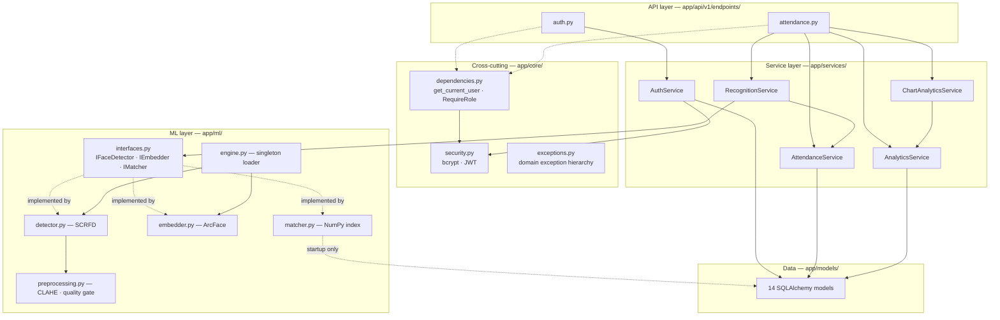
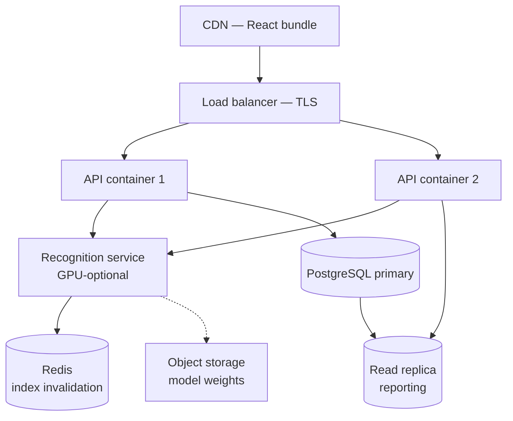

# Architecture Document
## AI-Powered Attendance Management System

**Version 1.0 · August 2026**

---

## 1. Architectural Style

### 1.1 The decision

Three candidates were evaluated.

| Approach | Verdict | Reason |
|----------|---------|--------|
| Microservices | ❌ Rejected | Requires service discovery, inter-service auth, distributed tracing, orchestration. Weeks of infrastructure for a solo developer. |
| Flat monolith | ❌ Rejected | Business logic tangles with HTTP handlers; untestable; the ML component cannot be extracted later. |
| **Modular monolith** | ✅ **Selected** | One deployable to debug, with strict internal boundaries that permit later extraction. |

**Why this is the correct answer rather than the convenient one.** Microservices solve an *organisational* problem — many teams deploying independently — not a technical one. With one developer, adopting them would be architecture theatre. Shopify, GitHub, and Stack Overflow all run large modular monoliths.

The defensible position is: build a modular monolith, and be able to name exactly which seams you would cut along to extract services later. Those seams are identified in §6.

### 1.2 Quality attributes driving the design

| Attribute | Design response |
|-----------|-----------------|
| Testability | Services import no web framework; ML sits behind interfaces |
| Correctness under concurrency | Duplicate prevention enforced by a database constraint, not application logic |
| Latency | Model loaded once; embedding index held in RAM |
| Security | Authorisation server-side, per-resource, on every request |
| Evolvability | API versioned; schema requires no migration to reach cloud deployment |

---

## 2. Layered Architecture

```
┌──────────────────────────────────────────────────────────────┐
│ PRESENTATION — React 18 + Vite + Tailwind                    │
│ Pages · Components · Routing · Auth context · API client     │
│ Responsibility: rendering and input. NO business rules.      │
└───────────────────────────┬──────────────────────────────────┘
                            │ HTTPS · JSON · JWT Bearer
┌───────────────────────────▼──────────────────────────────────┐
│ API — FastAPI routers                                        │
│ Routes · Pydantic schemas · Dependencies                     │
│ Responsibility: HTTP only — parse, validate, authorise,      │
│ delegate, serialise. NO business logic. NO SQL.              │
└───────────────────────────┬──────────────────────────────────┘
                            │ Python calls
┌───────────────────────────▼──────────────────────────────────┐
│ SERVICE — the rules of the system                            │
│ AuthService · AttendanceService · RecognitionService ·       │
│ AnalyticsService · ChartAnalyticsService                     │
│ "A student cannot be marked twice."                          │
│ "Faculty may only access their own offerings."               │
│ Framework-agnostic and unit-testable without a server.       │
└────────┬────────────────────────────────┬────────────────────┘
         │                                │
┌────────▼──────────────────┐  ┌──────────▼────────────────────┐
│ ML LAYER                  │  │ DATA ACCESS LAYER             │
│ Preprocessor · Detector   │  │ SQLAlchemy models             │
│ Embedder · Matcher        │  │ Alembic migrations            │
│ Behind interfaces (ABCs)  │  │ Session management            │
└────────┬──────────────────┘  └──────────┬────────────────────┘
         │                                │
┌────────▼──────────────────┐  ┌──────────▼────────────────────┐
│ InsightFace / ONNX        │  │ PostgreSQL 16                 │
│ SCRFD + ArcFace r100      │  │ 14 tables                     │
└───────────────────────────┘  └───────────────────────────────┘
```

**The invariant that makes this real:** dependencies point downward only. `attendance_service.py` imports SQLAlchemy and `app.core` — never FastAPI. If `HTTPException` ever appears in a service, the layering has broken; the service should raise a domain exception and let the handler in `main.py` translate it.

---

## 3. Component Structure



### 3.1 `interfaces.py` — the SOLID seam

The most important module in the diagram, and the one usually omitted.

`RecognitionService` depends on `IEmbedder`, not `ArcFaceEmbedder`. Two consequences:

1. **Testability.** A test injects a fake embedder returning fixed vectors, so attendance logic can be tested without a 275 MB model, a webcam, or a 5-second load. Tests drop from seconds to milliseconds.
2. **Replaceability.** Swapping the model means writing a new class implementing the same interface. Business logic does not change. This is also the seam along which the ML layer is extracted into a separate service in the cloud topology.

This is the Dependency Inversion Principle, and this module is where to point when asked where SOLID was applied.

### 3.2 The single service-to-service call

`RecognitionService → AttendanceService` is the only one, and it is deliberate. Recognition determines *who*; attendance determines *what to record*. Merging them would create a class that knows both computer vision and business rules — a Single Responsibility violation.

The separation is what allows `/recognition/identify` (read-only) and `/sessions/{id}/mark-face` (recognise and persist) to share recognition code with zero duplication, while the read-only endpoint carries no risk of writing attendance.

### 3.3 The engine singleton

Singletons are usually an anti-pattern. This is a genuine exception:

| | Value |
|---|---|
| Model load time | 5.5 s |
| Resident memory | ~500 MB |
| Inference per face | ~285 ms |

Loading per request would make every recognition take 5+ seconds and exhaust memory under any concurrency. Loading once at startup is the only viable design (NFR-1.4). Testability is preserved because services depend on the interfaces, not the singleton.

---

## 4. Data Flow

### 4.1 Level 0 — context

```
                    ┌───────────┐
                    │   ADMIN   │
                    └─────┬─────┘
        master data,      │   ▲ confirmations,
        credentials       ▼   │ analytics
   ┌──────────┐   ┌───────────────────────┐   ┌──────────┐
   │ FACULTY  │──▶│         0             │──▶│ STUDENT  │
   │          │◀──│  ATTENDANCE SYSTEM    │◀──│          │
   └──────────┘   └───────────┬───────────┘   └──────────┘
   credentials,               │   ▲
   camera frames,      face   │   │ identity +
   corrections         crop   ▼   │ confidence
                   ┌───────────────────────┐
                   │  RECOGNITION ENGINE   │
                   └───────────────────────┘
```

The database is **not** an external entity — it is inside the boundary.

### 4.2 The recognition path

```
Browser captures frame (2 fps)
   ↓ multipart JPEG q=0.8
POST /sessions/{id}/mark-face
   ↓
1. Session open?              → 409 if not
2. Faculty owns offering?     → 403 if not
   ↓
3. Preprocess: resize ≤640px, CLAHE on LAB L-channel      [5 ms]
4. Detect: SCRFD → boxes + 5 landmarks                    [257 ms, 6 faces]
   ↓ per face
5. Quality gate: size, blur, exposure, pose  → skip silently if failed
6. Align: similarity transform → 112×112 canonical
7. Embed: ArcFace → 512-d → L2 normalise                  [285 ms]
8. Match: index_matrix @ query, restricted to roster      [157 µs]
   ↓
9. ≥0.50 accept · 0.40–0.50 accept+review · <0.40 UNKNOWN
10. Enrolled in this offering? → reject if not
11. INSERT within SAVEPOINT; catch IntegrityError → idempotent
12. Log to recognition_logs
   ↓
Response: boxes + identities + confidences
```

---

## 5. Key Architectural Decisions

| # | Decision | Alternative rejected | Rationale |
|---|----------|---------------------|-----------|
| D-01 | Modular monolith | Microservices | Solves an organisational problem we don't have; seams preserved for extraction |
| D-02 | Service layer | Logic in route handlers | Testability, reuse, framework independence |
| D-03 | InsightFace SCRFD + ArcFace | dlib, FaceNet, Haar | Highest accuracy; detection + landmarks + embedding in one API; no compilation |
| D-04 | Server-side inference | Browser-side | A client must never be authoritative about identity |
| D-05 | In-memory NumPy index | Per-query DB search | 157 µs vs ~250 ms; pgvector is the documented Phase 2 path |
| D-06 | Embeddings as `BYTEA` | `REAL[]`, `JSONB` | 2,048 bytes exactly, lossless, zero-copy NumPy round-trip |
| D-07 | `UNIQUE(session_id, student_id)` | Application-level check | Eliminates the check-then-insert race under a 2 fps stream |
| D-08 | SAVEPOINT around the insert | Bare try/except | In PostgreSQL an IntegrityError aborts the whole transaction |
| D-09 | Three-band confidence | Single threshold | False acceptance is worse than false rejection; the grey band routes ambiguity to a human |
| D-10 | Roster-restricted search | Search all students | ~20× fewer candidates: faster *and* fewer false positives |
| D-11 | Single `users` table | Per-role login tables | Auth written once; new roles need no new auth code |
| D-12 | `subject_offerings` join entity | Attendance → subject directly | Without it, faculty ownership checks are unwritable |
| D-13 | Soft deletion | Hard deletion | Preserves referential integrity and history |
| D-14 | Mandatory face alignment | Crop and embed | Measured 0.980 vs 0.253 similarity on an 18°-rotated face |
| D-15 | CLAHE on LAB L-channel | Per-RGB equalisation | 3.98° vs 43.46° hue shift — a fairness decision, not aesthetics |
| D-16 | Detection-only path | `FaceAnalysis.get()` | 257 ms vs 2,337 ms — the convenience API ran ArcFace on every face |
| D-17 | Model loaded at startup | Per request | 5.5 s load; per-request would be catastrophic |
| D-18 | PyJWT, bcrypt direct | python-jose, passlib | Both originals unmaintained since 2020/2021 |
| D-19 | Chart.js | Recharts | 183 kB vs 360 kB; one library rather than two |
| D-20 | Bundled analytics endpoint | Five separate calls | Guarantees the five charts describe the same moment |

---

## 6. Deployment Topologies and the Migration Path

### A — Development / demo (single machine)

Everything on one laptop. React on `:5173`, FastAPI on `:8000`, PostgreSQL on `:5432`. **The camera works only because the origin is `localhost`.**

### B — Institutional pilot (LAN)

Nginx terminates TLS on `:443` and serves the built React bundle; multiple Uvicorn workers behind it; nightly `pg_dump`.

TLS becomes **mandatory**, not optional: clients are on `192.168.x.x`, so `getUserMedia` requires HTTPS.

> ⚠️ **Known defect at this tier.** The embedding index is per-worker. Enrolling a student refreshes it in whichever worker handled the request; other workers keep a stale index and will not recognise the new student. Documented rather than hidden; solved in Topology C.

### C — Production (cloud)



The ML tier becomes a separate service — the seam identified in §3.1. **Because the ML layer already sits behind `interfaces.py`, this extraction requires no change to business logic.** Redis pub/sub fixes the stale-index defect.

### Migration cost

| Change | A → B | B → C |
|--------|-------|-------|
| Application code | None | Extract ML behind HTTP; add Redis client |
| **Database schema** | **None** | **None** |
| Configuration | `.env` values | `.env` + service discovery |

The schema row is the point. Because offerings, soft deletion, and model versioning were designed in from the start, growing from a laptop to a cloud deployment requires no migration. That is what "designed for commercialisation" means concretely — not that cloud infrastructure was built, but that nothing built now prevents it.

---

## 7. Scalability Ceilings

| Component | Current limit | First bottleneck | Fix |
|-----------|--------------|------------------|-----|
| Embedding search | ~50,000 students | Linear scan >50 ms | pgvector + HNSW |
| **CPU inference** | **~3.5 faces/sec/worker** | **285 ms/face** | **GPU node, or more ML replicas** |
| API throughput | ~50 concurrent | Uvicorn worker count | Horizontal scale (stateless) |
| PostgreSQL writes | ~5,000 records/day | Not a bottleneck at this scale | PgBouncer, then partitioning |
| Reporting queries | ~1M records | Full-table aggregation | Read replica, materialised views |

**The honest headline:** at the stated target of 1,000 students, every component has substantial headroom. The first thing to break under growth is not the database — it is CPU inference throughput. A 500-student assembly would take over two minutes. That is the number to quote when asked about limits, and the answer is that the ML tier scales independently precisely because it was designed as a separable component.

---

*End of Architecture Document v1.0*
