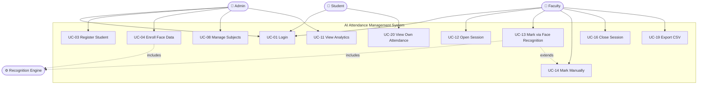
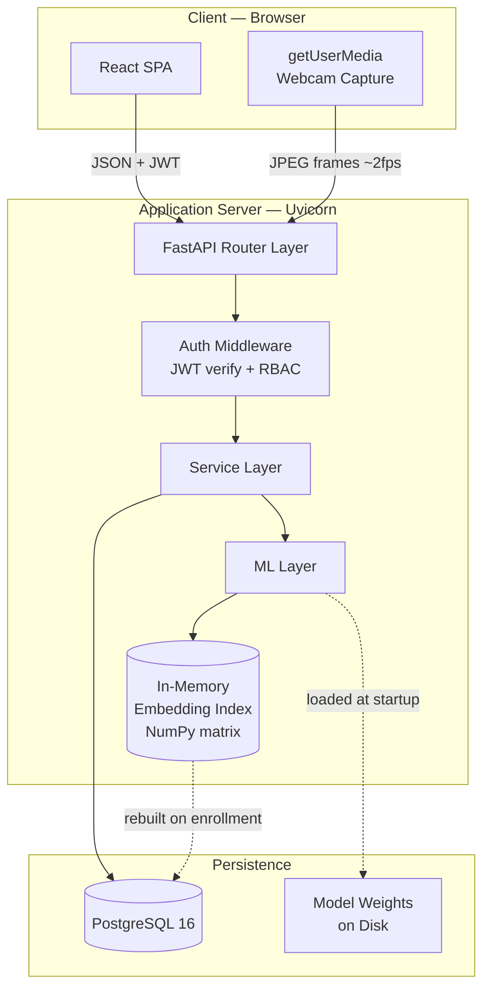

# AI-Powered Attendance Management System
## Complete Software Design Document

**Version:** 1.0
**Date:** August 2026
**Status:** Design Phase — Approved for Implementation
**Author:** [Your Name]
**Constraint:** 3-week solo build, Windows development environment

---

# 1. Project Scope

## 1.1 Problem Statement

Manual attendance in colleges consumes 5–10 minutes of every lecture. Across a 6-hour teaching day that is roughly one full period lost per class per week. Manual registers are also vulnerable to proxy attendance ("buddy punching"), are difficult to aggregate into reports, and give students no real-time visibility into their own attendance percentage until it is too late to fix.

## 1.2 Solution Statement

A web-based system where faculty open a class session on their laptop, point the webcam at the class (or let students file past it), and the system identifies each registered student using face recognition, marking them present automatically. Faculty retain full override control. Students and administrators access the resulting data through role-specific dashboards.

## 1.3 Scope Definition

Scope is defined in three tiers. **Tier 1 is the contract** — the project is considered successful if and only if all Tier 1 items work reliably.

### Tier 1 — In Scope (Must Build)

| ID | Capability |
|----|-----------|
| S-01 | User authentication with three roles (Admin, Faculty, Student) |
| S-02 | Student registration with multi-image face capture and embedding generation |
| S-03 | Real-time face detection from webcam feed |
| S-04 | Face recognition against registered students with confidence scoring |
| S-05 | Unknown-face detection (person not in database) |
| S-06 | Attendance session lifecycle (open → mark → close) |
| S-07 | Duplicate-prevention (one attendance record per student per session) |
| S-08 | Manual override — faculty can correct any auto-marked record |
| S-09 | Faculty dashboard: take attendance, view/filter records |
| S-10 | Student dashboard: percentage, present/absent counts, subject-wise breakdown, history |
| S-11 | Admin: CRUD on students, faculty, subjects |
| S-12 | CSV export of attendance data |
| S-13 | Role-based access control on every endpoint |

### Tier 2 — In Scope If Time Permits

| ID | Capability |
|----|-----------|
| S-14 | Analytics charts (attendance trends, at-risk students) |
| S-15 | PDF report generation |
| S-16 | Multi-face recognition from a single classroom photo |
| S-17 | Basic passive liveness / anti-spoofing check |
| S-18 | Audit log viewer |

### Tier 3 — Explicitly Out of Scope (Documented as Phase 2)

Geofencing, GPS verification, SMS notifications, email notifications, QR-code fallback attendance, heat maps, mobile native app, Docker deployment, multi-tenancy, LMS integration, offline mode.

> **Why explicitly document what you are NOT building?**
> In industry this is called a *scope boundary*, and it is the most important paragraph in any PRD. It protects you from scope creep, and in an academic defence it demonstrates engineering judgement rather than omission. The database schema and API design below are deliberately built so that every Tier 3 item can be added later **without schema migration** — that is what "designed for commercialization" actually means in practice.

## 1.4 Assumptions

- Single institution, single deployment (multi-tenancy is Phase 2).
- Target scale: up to 1,000 registered students, up to 50 concurrent users.
- Faculty device has a functioning webcam and runs a modern browser.
- Students consent to biometric enrollment (captured explicitly at registration).
- Deployment on `localhost` or LAN for demonstration; cloud deployment is Phase 2.

## 1.5 Success Criteria

| Metric | Target |
|--------|--------|
| Recognition accuracy (good lighting, enrolled student) | ≥ 95% true positive rate |
| False acceptance rate (wrong student identified) | ≤ 1% |
| Unknown person correctly rejected | ≥ 90% |
| Time to mark one student | ≤ 2 seconds end-to-end |
| Time to mark a 40-student class | ≤ 3 minutes |
| API response time (non-ML endpoints), 95th percentile | ≤ 300 ms |

---

# 2. Requirements Specification

## 2.1 Functional Requirements

Requirements are written in the standard form: *"The system shall…"*. Each has a unique ID so that code, tests, and this document can be cross-referenced — this traceability is what auditors and examiners look for.

### FR-1: Authentication & Authorization

| ID | Requirement | Priority |
|----|-------------|----------|
| FR-1.1 | The system shall allow users to log in using email and password. | Must |
| FR-1.2 | The system shall hash all passwords using bcrypt before storage. | Must |
| FR-1.3 | The system shall issue a short-lived JWT access token (30 min) and a long-lived refresh token (7 days) on successful login. | Must |
| FR-1.4 | The system shall assign exactly one role (Admin, Faculty, Student) to each user. | Must |
| FR-1.5 | The system shall reject any API request whose token role lacks permission for that endpoint. | Must |
| FR-1.6 | The system shall allow a user to log out, invalidating the refresh token. | Must |
| FR-1.7 | The system shall lock an account for 15 minutes after 5 consecutive failed login attempts. | Should |

### FR-2: Student Registration & Enrollment

| ID | Requirement | Priority |
|----|-------------|----------|
| FR-2.1 | The system shall allow an Admin to register a student with name, roll number, department, semester, email, and phone. | Must |
| FR-2.2 | The system shall enforce uniqueness of roll number and email. | Must |
| FR-2.3 | The system shall capture a minimum of 5 and maximum of 15 face images per student. | Must |
| FR-2.4 | The system shall reject a face image if no face is detected, more than one face is detected, or the detection confidence is below threshold. | Must |
| FR-2.5 | The system shall compute a 512-dimension embedding for each accepted face image. | Must |
| FR-2.6 | The system shall store the mean of all embeddings as the student's primary reference embedding. | Must |
| FR-2.7 | The system shall record explicit biometric consent with a timestamp at registration. | Must |
| FR-2.8 | The system shall allow re-enrollment (replacing face data) without affecting historical attendance. | Should |

### FR-3: Face Detection & Recognition

| ID | Requirement | Priority |
|----|-------------|----------|
| FR-3.1 | The system shall detect all faces present in a submitted frame. | Must |
| FR-3.2 | The system shall return bounding box coordinates and a detection confidence for each face. | Must |
| FR-3.3 | The system shall align each detected face using facial landmarks before embedding. | Must |
| FR-3.4 | The system shall compute cosine similarity between the query embedding and all active student embeddings. | Must |
| FR-3.5 | The system shall classify a face as "recognized" only if the highest similarity exceeds the configured threshold. | Must |
| FR-3.6 | The system shall classify a face as "unknown" if no similarity exceeds the threshold. | Must |
| FR-3.7 | The system shall return the confidence score with every recognition result. | Must |
| FR-3.8 | The system shall log every recognition attempt, including failures and unknowns. | Must |
| FR-3.9 | The system shall support recognition of multiple faces from a single classroom image. | Should |

### FR-4: Attendance Management

| ID | Requirement | Priority |
|----|-------------|----------|
| FR-4.1 | The system shall allow Faculty to open an attendance session for a subject they teach. | Must |
| FR-4.2 | The system shall record subject, faculty, date, start time, and room for each session. | Must |
| FR-4.3 | The system shall prevent more than one attendance record per student per session (database-enforced). | Must |
| FR-4.4 | The system shall record marking method (face / manual) and confidence for each record. | Must |
| FR-4.5 | The system shall allow Faculty to manually add, remove, or change any record within an open session. | Must |
| FR-4.6 | The system shall mark all enrolled-but-unrecognized students as absent when a session is closed. | Must |
| FR-4.7 | The system shall prevent modification of records in a closed session except by Admin. | Should |
| FR-4.8 | The system shall support statuses: Present, Absent, Late, Excused. | Should |

### FR-5: Dashboards & Reporting

| ID | Requirement | Priority |
|----|-------------|----------|
| FR-5.1 | The system shall display to each Student their overall attendance percentage. | Must |
| FR-5.2 | The system shall display subject-wise attendance breakdown per student. | Must |
| FR-5.3 | The system shall display a chronological attendance history per student. | Must |
| FR-5.4 | The system shall allow Faculty to filter attendance by subject, date range, and student. | Must |
| FR-5.5 | The system shall allow Faculty and Admin to export filtered attendance as CSV. | Must |
| FR-5.6 | The system shall flag students below a configurable attendance threshold (default 75%). | Should |
| FR-5.7 | The system shall generate PDF daily and monthly reports. | Could |
| FR-5.8 | The system shall render attendance trend charts. | Could |

### FR-6: Administration

| ID | Requirement | Priority |
|----|-------------|----------|
| FR-6.1 | The system shall allow Admin to create, read, update, and deactivate students. | Must |
| FR-6.2 | The system shall allow Admin to create, read, update, and deactivate faculty. | Must |
| FR-6.3 | The system shall allow Admin to manage subjects and assign faculty to subjects. | Must |
| FR-6.4 | The system shall allow Admin to enroll students into subjects. | Must |
| FR-6.5 | The system shall use soft deletion (deactivation) rather than hard deletion for all entities referenced by attendance records. | Must |
| FR-6.6 | The system shall record an audit log entry for every create, update, and delete operation. | Should |

## 2.2 Non-Functional Requirements

Non-functional requirements describe *how well* the system does things, rather than *what* it does. Beginners usually skip these; they are precisely where production systems are won or lost.

### NFR-1: Performance

| ID | Requirement | Rationale |
|----|-------------|-----------|
| NFR-1.1 | Face detection + recognition of a single face shall complete in ≤ 2 s on CPU. | A queue of 40 students cannot tolerate slower. |
| NFR-1.2 | Non-ML API endpoints shall respond within 300 ms at the 95th percentile. | Perceived UI responsiveness. |
| NFR-1.3 | The embedding index shall be held in memory, not queried per-face from the database. | 1,000 DB round-trips per face is architecturally wrong. |
| NFR-1.4 | The AI model shall be loaded once at application startup, not per request. | Model load takes ~3 s; per-request loading would be catastrophic. |
| NFR-1.5 | Dashboard pages shall load in ≤ 1.5 s on a LAN connection. | Usability. |

### NFR-2: Security

| ID | Requirement | Rationale |
|----|-------------|-----------|
| NFR-2.1 | Passwords shall be stored only as bcrypt hashes with per-password salt. | Plaintext or unsalted hashes are indefensible. |
| NFR-2.2 | All API endpoints except login and health-check shall require a valid JWT. | Default-deny posture. |
| NFR-2.3 | Authorization shall be enforced server-side; UI hiding is not access control. | Client-side checks are trivially bypassed. |
| NFR-2.4 | Face embeddings shall never be returned by any API response. | Biometric templates are the crown jewels. |
| NFR-2.5 | All user input shall be validated and typed via Pydantic schemas. | Injection and type-confusion defence. |
| NFR-2.6 | Database access shall use parameterized queries via the ORM exclusively. | SQL injection defence. |
| NFR-2.7 | Secrets shall be loaded from environment variables, never committed to version control. | Credential leakage is the most common student-project vulnerability. |
| NFR-2.8 | A student shall be able to access only their own attendance data. | Horizontal privilege escalation defence — commonly missed. |

### NFR-3: Privacy & Compliance

| ID | Requirement | Rationale |
|----|-------------|-----------|
| NFR-3.1 | Explicit consent shall be recorded before any biometric enrollment. | Required under India's DPDP Act 2023 and GDPR Art. 9. |
| NFR-3.2 | Raw enrollment images shall be deleted after embedding extraction; only embeddings are retained. | Minimizes breach impact — an embedding is far harder to misuse than a photo. |
| NFR-3.3 | Recognition frames captured during attendance shall not be persisted by default. | Data minimization. |
| NFR-3.4 | The system shall support complete deletion of a student's biometric data on request. | Right to erasure. |

### NFR-4: Reliability & Accuracy

| ID | Requirement |
|----|-------------|
| NFR-4.1 | The recognition threshold shall be configurable without code changes. |
| NFR-4.2 | The system shall degrade gracefully to manual marking if the camera or ML service fails. |
| NFR-4.3 | Duplicate prevention shall be enforced by a database constraint, not application logic alone. |
| NFR-4.4 | All timestamps shall be stored in UTC and rendered in the institution's local timezone. |

### NFR-5: Maintainability & Scalability

| ID | Requirement |
|----|-------------|
| NFR-5.1 | Business logic shall reside in a service layer, isolated from HTTP handlers and database models. |
| NFR-5.2 | The ML recognition component shall sit behind an interface, allowing model replacement without touching business logic. |
| NFR-5.3 | Database schema changes shall be managed through versioned Alembic migrations. |
| NFR-5.4 | The API shall be versioned (`/api/v1/...`) from day one. |
| NFR-5.5 | The system shall support horizontal scaling of the API layer (stateless services, no in-process session state). |

### NFR-6: Usability

| ID | Requirement |
|----|-------------|
| NFR-6.1 | The UI shall be responsive across desktop, tablet, and mobile viewports. |
| NFR-6.2 | The UI shall support light and dark themes with persisted preference. |
| NFR-6.3 | Recognition results shall be shown as live visual feedback (name + confidence overlay). |
| NFR-6.4 | Every destructive action shall require explicit confirmation. |

---

# 3. Actors and Use Cases

## 3.1 Actor Catalogue

| Actor | Type | Description | Trust Level |
|-------|------|-------------|-------------|
| **Admin** | Primary, human | Institution IT staff or HOD. Manages all master data. | Highest |
| **Faculty** | Primary, human | Teaching staff. Conducts sessions, marks and reviews attendance for their own subjects only. | Medium |
| **Student** | Primary, human | Enrolled learner. Read-only access to their own data. | Lowest |
| **Recognition Engine** | Secondary, system | InsightFace subsystem. Consumes frames, produces identities. | Internal |
| **Database** | Secondary, system | PostgreSQL. Persists all state. | Internal |

> **Design note on Faculty trust level:** Faculty are *not* fully trusted. A faculty member must not be able to view or modify attendance for a subject they do not teach. This is enforced at the service layer by checking subject ownership on every request — not merely by hiding menu items in the UI.

## 3.2 Use Case Catalogue

| UC ID | Use Case | Primary Actor | Preconditions |
|-------|----------|---------------|---------------|
| UC-01 | Log in | All | Account exists and is active |
| UC-02 | Log out | All | Authenticated |
| UC-03 | Register new student | Admin | Authenticated as Admin |
| UC-04 | Enroll student face data | Admin | Student record exists; consent given |
| UC-05 | Update student details | Admin | Student exists |
| UC-06 | Deactivate student | Admin | Student exists |
| UC-07 | Manage faculty accounts | Admin | Authenticated as Admin |
| UC-08 | Manage subjects | Admin | Authenticated as Admin |
| UC-09 | Assign faculty to subject | Admin | Faculty and subject exist |
| UC-10 | Enroll students into subject | Admin | Students and subject exist |
| UC-11 | View system analytics | Admin | Attendance data exists |
| UC-12 | Open attendance session | Faculty | Faculty assigned to that subject |
| UC-13 | Mark attendance via face recognition | Faculty | Session open; camera available |
| UC-14 | Mark attendance manually | Faculty | Session open |
| UC-15 | Correct an attendance record | Faculty | Session open; record exists |
| UC-16 | Close attendance session | Faculty | Session open |
| UC-17 | View attendance records | Faculty | Owns the subject |
| UC-18 | Filter and search attendance | Faculty | Records exist |
| UC-19 | Export attendance to CSV | Faculty, Admin | Records exist |
| UC-20 | View own attendance summary | Student | Enrolled in ≥1 subject |
| UC-21 | View own attendance history | Student | Records exist |
| UC-22 | View low-attendance warning | Student | Below threshold |

## 3.3 Detailed Use Case: UC-13 (The Core Use Case)

This is the heart of the system, so it is specified in full detail. Every other use case follows the same template.

**Use Case:** Mark attendance via face recognition
**Actor:** Faculty
**Goal:** Record present status for students physically in the classroom
**Preconditions:** Faculty authenticated; session open; browser camera permission granted; recognition service healthy

**Main Success Scenario:**
1. Faculty selects an open session and clicks "Start Camera".
2. Browser requests camera permission; user grants it.
3. Frontend begins capturing frames at ~2 frames per second.
4. Frontend sends each frame as a JPEG to the recognition endpoint.
5. Backend decodes the frame and runs face detection.
6. For each detected face, backend aligns, extracts a 512-d embedding, and computes cosine similarity against the in-memory index of students enrolled in this subject.
7. Backend returns bounding boxes with matched student names and confidences.
8. Frontend draws boxes and labels over the live video.
9. When a match exceeds the threshold, backend writes an attendance record (Present, method=face, with confidence).
10. Frontend appends the student to a live "Marked Present" list.
11. Faculty closes the session; backend marks all remaining enrolled students Absent.

**Extensions (Alternate Flows):**
- **3a. Camera permission denied:** System displays manual marking interface (UC-14). *Graceful degradation, per NFR-4.2.*
- **5a. No face detected:** Frame is discarded silently; no error shown. *Avoids flicker at ~2 fps.*
- **6a. No match above threshold:** Face labelled "Unknown" in red; no record written; event logged for audit.
- **9a. Student already marked in this session:** Database unique constraint rejects the insert; backend returns the existing record; no duplicate created. *This is FR-4.3 enforced at the correct layer.*
- **9b. Match confidence between low and high thresholds:** Record written with `needs_review = true`; faculty prompted to confirm. *Reduces false positives without blocking the flow.*
- **11a. Session closed accidentally:** Admin can reopen (audit-logged).

**Postconditions:** Every student enrolled in the subject has exactly one attendance record for this session.

## 3.4 Use Case Diagram (Mermaid)

Paste this into <https://mermaid.live> to render and export an image for your report.



---

# 4. System Architecture

## 4.1 Architectural Style Decision

Three candidate architectures were evaluated.

| Approach | Pros | Cons | Verdict |
|----------|------|------|---------|
| **Microservices** (separate auth, ML, attendance services) | Independent scaling; ML service can get a GPU node; fault isolation | Requires service discovery, inter-service auth, distributed tracing, container orchestration. Weeks of infrastructure work for a solo developer. | ❌ Rejected — infrastructure cost vastly exceeds benefit at this scale |
| **Monolith** (single flat FastAPI app) | Fastest to build | Business logic tangles with HTTP handlers; untestable; cannot extract the ML component later | ❌ Rejected — fails NFR-5.1, NFR-5.2 |
| **Modular Monolith** (layered, single deployable) | Single process to deploy and debug; strict internal layer boundaries mean any module can later be extracted into a service | Requires discipline to maintain boundaries | ✅ **Selected** |

> **Why this is the professionally correct answer, not just the convenient one:** Modular monolith is the current mainstream recommendation for new systems (Shopify, GitHub, and Stack Overflow all run enormous modular monoliths). Microservices are a solution to an *organizational* problem — many teams deploying independently — not a technical one. You have one team member. Adopting microservices here would be architecture cosplay, and a sharp examiner will say so. Building a *modular* monolith and being able to explain exactly which seams you would cut along to extract services later is the answer that demonstrates real seniority.

## 4.2 Layered Architecture

```
┌──────────────────────────────────────────────────────────────────┐
│  PRESENTATION LAYER  (React 18 + Vite + Tailwind)                │
│  Pages · Components · Routing · Auth Context · API Client        │
│  Responsibility: rendering and user interaction ONLY.            │
│  Contains NO business rules.                                     │
└────────────────────────────┬─────────────────────────────────────┘
                             │  HTTPS / JSON  ·  JWT Bearer token
┌────────────────────────────▼─────────────────────────────────────┐
│  API LAYER  (FastAPI routers)                                    │
│  Route definitions · Request/response schemas · Dependencies      │
│  Responsibility: HTTP concerns — parse, validate, authorize,      │
│  delegate, serialize. NO business logic. NO SQL.                 │
└────────────────────────────┬─────────────────────────────────────┘
                             │  Python function calls
┌────────────────────────────▼─────────────────────────────────────┐
│  SERVICE LAYER  (business logic)                                 │
│  AuthService · StudentService · AttendanceService ·              │
│  RecognitionService · ReportService · AnalyticsService           │
│  Responsibility: THE RULES OF THE SYSTEM.                        │
│  "A student cannot be marked twice." "Faculty may only           │
│  access their own subjects." Framework-agnostic and unit-        │
│  testable without a running server.                              │
└──────────┬─────────────────────────────────┬─────────────────────┘
           │                                 │
┌──────────▼──────────────────┐  ┌───────────▼─────────────────────┐
│  ML LAYER                   │  │  DATA ACCESS LAYER              │
│  FaceDetector               │  │  SQLAlchemy models              │
│  EmbeddingExtractor         │  │  Repository functions           │
│  FaceMatcher (in-memory)    │  │  Alembic migrations             │
│  ImagePreprocessor          │  │  Session management             │
│  Behind an interface so the │  │  Responsibility: persistence    │
│  model can be swapped.      │  │  ONLY. No business rules.       │
└──────────┬──────────────────┘  └───────────┬─────────────────────┘
           │                                 │
┌──────────▼──────────────────┐  ┌───────────▼─────────────────────┐
│  InsightFace (ONNX Runtime) │  │  PostgreSQL 16                  │
│  SCRFD detector             │  │                                 │
│  ArcFace r100 embedder      │  │                                 │
└─────────────────────────────┘  └─────────────────────────────────┘
```

**The one rule that makes this architecture real:** dependencies point *downward only*. The service layer never imports from the API layer. The data layer never imports from services. If you ever find yourself needing an upward import, the design is wrong — extract an interface instead.

## 4.3 Runtime Component Diagram



## 4.4 Key Architectural Decision: In-Memory Embedding Index

This is the single most important performance decision in the system, so it deserves its own justification.

**The problem:** To recognize one face, you must compare its embedding against every enrolled student's embedding. With 1,000 students, that is 1,000 comparisons — per face, per frame, at 2 frames per second.

| Option | Mechanism | Latency @1,000 students | Verdict |
|--------|-----------|------------------------|---------|
| Query DB per comparison | 1,000 SELECT statements per face | ~5,000 ms | ❌ Absurd |
| Load all embeddings from DB per frame | 1 SELECT, then compare in Python | ~250 ms | ❌ Wasteful; DB hit on every frame |
| **In-memory NumPy matrix** | Load once at startup into a (N × 512) array; one vectorized matrix multiply | **~1 ms** | ✅ **Selected** |
| pgvector extension with HNSW index | Approximate nearest neighbour in the database | ~5 ms | ⏭️ Phase 2 (>50,000 students) |

**How the selected approach works:** All embeddings are L2-normalized at storage time. Cosine similarity between normalized vectors is simply their dot product. So recognizing a face against all 1,000 students becomes a single matrix–vector multiplication — `index_matrix @ query_vector` — which NumPy executes in well under a millisecond using optimized BLAS routines.

**Consistency handling:** The index is rebuilt when a student is enrolled or deactivated. Because the API layer is designed to be stateless-scalable (NFR-5.5), the multi-instance version of this uses a Redis pub/sub invalidation message — noted here as the Phase 2 upgrade path.

---

# 5. Data Flow Diagrams

## 5.1 DFD Level 0 — Context Diagram

The context diagram shows the system as a single process, defining its boundary with the outside world. Every arrow is a data flow; every box is an external entity.

```
                    ┌──────────────────┐
                    │      ADMIN       │
                    └────────┬─────────┘
              student/faculty│    ▲ confirmations,
              /subject data  │    │ analytics
                             ▼    │
   ┌────────────┐      ┌─────────────────────────┐      ┌────────────┐
   │            │─────▶│                         │─────▶│            │
   │  FACULTY   │      │      0                  │      │  STUDENT   │
   │            │◀─────│  AI ATTENDANCE          │◀─────│            │
   └────────────┘      │  MANAGEMENT SYSTEM      │      └────────────┘
   session control,    │                         │   login credentials
   camera frames,      │                         │        ▲
   corrections         └─────────────────────────┘        │
        ▲                        ▲   │                    │
        │ attendance lists,      │   │ recognition        │ attendance %,
        │ CSV exports           │   │ requests           │ history,
                                │   ▼                     │ warnings
                    ┌───────────────────────────┐
                    │   RECOGNITION ENGINE      │
                    │   (InsightFace)           │
                    └───────────────────────────┘
                      returns: identity + confidence
```

**Reading it:** The system has exactly four external entities and one boundary. Note that the database is *not* shown at Level 0 — the database is internal to the system, not an external entity. Students consistently get this wrong.

## 5.2 DFD Level 1 — Major Processes

Level 1 decomposes process 0 into its constituent processes and reveals the data stores.

```
 ADMIN                    FACULTY                   STUDENT
   │                         │                         │
   │ credentials             │ credentials             │ credentials
   └────────────┬────────────┴────────────┬────────────┘
                ▼                         ▼
        ┌───────────────────────────────────────┐
        │  1.0  AUTHENTICATE & AUTHORIZE        │◀────┐
        │  Verify password, issue JWT, check    │     │
        │  role permissions                     │     │
        └───────────────┬───────────────────────┘     │
                        │ JWT token                   │ user record
                        │                             │
     ┌──────────────────┼──────────────────┐   ┌──────┴──────┐
     │                  │                  │   │ D1  USERS   │
     ▼                  ▼                  ▼   │     & ROLES │
┌─────────────┐  ┌─────────────┐  ┌─────────────┐└───────────┘
│ 2.0         │  │ 3.0         │  │ 6.0         │
│ MANAGE      │  │ CAPTURE &   │  │ GENERATE    │
│ MASTER DATA │  │ ENROLL FACE │  │ REPORTS &   │
│             │  │             │  │ ANALYTICS   │
│ CRUD on     │  │ Detect,     │  │             │
│ students,   │  │ validate,   │  │ Aggregate,  │
│ faculty,    │  │ align,      │  │ compute %,  │
│ subjects,   │  │ embed, mean │  │ export CSV  │
│ enrollments │  │             │  │             │
└──────┬──────┘  └──────┬──────┘  └──────▲──────┘
       │                │                │
       ▼                ▼                │
┌──────────────┐ ┌──────────────┐        │
│ D2 STUDENTS  │ │ D3 FACE      │        │
│    FACULTY   │ │    EMBEDDINGS│        │
│    SUBJECTS  │ └──────┬───────┘        │
│    ENROLL.   │        │                │
└──────┬───────┘        │ reference      │
       │                │ embeddings     │
       │ enrolled       ▼                │
       │ roster  ┌─────────────────┐     │
       │         │ 4.0             │     │
       │         │ RECOGNIZE FACE  │     │
       │         │                 │     │
FACULTY├────────▶│ Detect → align  │     │
 camera│ frames  │ → preprocess →  │     │
 frames│         │ embed → match   │     │
       │         │ → threshold     │     │
       │         └────────┬────────┘     │
       │                  │ student_id   │
       │                  │ + confidence │
       │                  ▼              │
       │         ┌─────────────────┐     │
       └────────▶│ 5.0             │     │
        session  │ MARK ATTENDANCE │     │
        control  │                 │     │
                 │ Validate session│     │
                 │ Check duplicate │     │
                 │ Write record    │     │
                 │ Close → absent  │     │
                 └────────┬────────┘     │
                          │              │
                          ▼              │
                 ┌──────────────────┐    │
                 │ D4 ATTENDANCE    │────┘
                 │    SESSIONS      │
                 │    RECORDS       │
                 └──────────────────┘
                          │
                          ▼
                 ┌──────────────────┐
                 │ D5 AUDIT &       │
                 │    RECOGNITION   │
                 │    LOGS          │
                 └──────────────────┘
```

### Process Descriptions

| Process | Input | Processing | Output | Data Stores |
|---------|-------|------------|--------|-------------|
| **1.0 Authenticate** | Email, password | Verify bcrypt hash; generate JWT with role claim; verify token on subsequent calls | JWT tokens; auth decisions | D1 (read/write) |
| **2.0 Manage Master Data** | Entity payloads | Validate; enforce uniqueness; soft-delete; write audit entry | Confirmations; entity records | D2 (write), D5 (write) |
| **3.0 Capture & Enroll Face** | 5–15 face images | Detect → validate single face → align → preprocess → embed (512-d) → L2 normalize → mean → store | Enrollment status; quality score | D3 (write), D2 (read) |
| **4.0 Recognize Face** | JPEG frame | Detect all faces → align → preprocess → embed → cosine match vs in-memory index → threshold | student_id + confidence, or UNKNOWN | D3 (read), D5 (write) |
| **5.0 Mark Attendance** | student_id, session_id, confidence | Verify session open; verify student enrolled; check duplicate constraint; write record | Attendance record | D4 (write), D2 (read) |
| **6.0 Reports & Analytics** | Filter criteria | Aggregate counts; compute percentages; flag below-threshold; serialize CSV/PDF | Dashboards; export files | D4 (read), D2 (read) |

---

# 6. Database Design

## 6.1 Design Principles Applied

1. **Third Normal Form (3NF)** throughout — no repeating groups, no partial dependencies, no transitive dependencies.
2. **Surrogate primary keys** (`BIGSERIAL`) everywhere, with natural keys (roll number, subject code) enforced as `UNIQUE` constraints. Natural keys change; surrogate keys never do.
3. **Soft deletion** via `is_active` on all entities referenced by attendance. Hard-deleting a student whose attendance is on record would either destroy history or break referential integrity.
4. **UTC timestamps** with `TIMESTAMPTZ`, rendered in local time by the presentation layer.
5. **Constraints in the database, not just the application.** Application-only validation fails the moment a second client, a script, or a bug bypasses it.

## 6.2 Entity-Relationship Diagram

```mermaid
erDiagram
    ROLES ||--o{ USERS : "assigns"
    USERS ||--o| STUDENTS : "is-a"
    USERS ||--o| FACULTY : "is-a"
    DEPARTMENTS ||--o{ STUDENTS : "contains"
    DEPARTMENTS ||--o{ FACULTY : "employs"
    DEPARTMENTS ||--o{ SUBJECTS : "offers"
    STUDENTS ||--o{ FACE_EMBEDDINGS : "has"
    SUBJECTS ||--o{ SUBJECT_OFFERINGS : "instantiated-as"
    FACULTY ||--o{ SUBJECT_OFFERINGS : "teaches"
    SUBJECT_OFFERINGS ||--o{ ENROLLMENTS : "has"
    STUDENTS ||--o{ ENROLLMENTS : "enrolled-in"
    SUBJECT_OFFERINGS ||--o{ ATTENDANCE_SESSIONS : "scheduled-as"
    ATTENDANCE_SESSIONS ||--o{ ATTENDANCE_RECORDS : "contains"
    STUDENTS ||--o{ ATTENDANCE_RECORDS : "receives"
    ATTENDANCE_SESSIONS ||--o{ RECOGNITION_LOGS : "generates"
    USERS ||--o{ AUDIT_LOGS : "performs"
    USERS ||--o{ REFRESH_TOKENS : "owns"

    ROLES {
        int id PK
        varchar name UK
    }
    USERS {
        bigint id PK
        varchar email UK
        varchar password_hash
        int role_id FK
        varchar full_name
        boolean is_active
        timestamptz created_at
    }
    STUDENTS {
        bigint id PK
        bigint user_id FK-UK
        varchar roll_number UK
        int department_id FK
        int semester
        varchar phone
        timestamptz consent_given_at
        boolean is_active
    }
    FACULTY {
        bigint id PK
        bigint user_id FK-UK
        varchar employee_code UK
        int department_id FK
        varchar designation
    }
    SUBJECTS {
        int id PK
        varchar code UK
        varchar name
        int department_id FK
        int semester
    }
    SUBJECT_OFFERINGS {
        bigint id PK
        int subject_id FK
        bigint faculty_id FK
        varchar section
        varchar academic_year
        boolean is_active
    }
    ENROLLMENTS {
        bigint id PK
        bigint student_id FK
        bigint offering_id FK
    }
    FACE_EMBEDDINGS {
        bigint id PK
        bigint student_id FK
        bytea embedding
        varchar model_name
        real quality_score
        boolean is_active
    }
    ATTENDANCE_SESSIONS {
        bigint id PK
        bigint offering_id FK
        date session_date
        timestamptz started_at
        timestamptz ended_at
        varchar status
        varchar room
    }
    ATTENDANCE_RECORDS {
        bigint id PK
        bigint session_id FK
        bigint student_id FK
        varchar status
        varchar method
        real confidence
        boolean needs_review
        timestamptz marked_at
    }
    RECOGNITION_LOGS {
        bigint id PK
        bigint session_id FK
        bigint matched_student_id FK
        real confidence
        boolean is_unknown
        timestamptz captured_at
    }
    AUDIT_LOGS {
        bigint id PK
        bigint user_id FK
        varchar action
        varchar entity_type
        bigint entity_id
        timestamptz created_at
    }
    REFRESH_TOKENS {
        bigint id PK
        bigint user_id FK
        varchar token_hash
        timestamptz expires_at
        timestamptz revoked_at
    }
```

## 6.3 Table Schemas

### `roles`
| Column | Type | Constraints | Notes |
|--------|------|-------------|-------|
| id | SERIAL | PK | |
| name | VARCHAR(20) | UNIQUE, NOT NULL | 'admin', 'faculty', 'student' |
| description | VARCHAR(200) | | |

### `users`
| Column | Type | Constraints | Notes |
|--------|------|-------------|-------|
| id | BIGSERIAL | PK | |
| email | VARCHAR(150) | UNIQUE, NOT NULL | Login identifier |
| password_hash | VARCHAR(255) | NOT NULL | bcrypt, cost factor 12 |
| full_name | VARCHAR(150) | NOT NULL | |
| role_id | INT | FK → roles.id, NOT NULL | |
| is_active | BOOLEAN | NOT NULL DEFAULT true | Soft delete flag |
| failed_login_count | INT | NOT NULL DEFAULT 0 | Supports FR-1.7 |
| locked_until | TIMESTAMPTZ | NULL | |
| last_login_at | TIMESTAMPTZ | NULL | |
| created_at | TIMESTAMPTZ | NOT NULL DEFAULT now() | |
| updated_at | TIMESTAMPTZ | NOT NULL DEFAULT now() | |

*Index:* `idx_users_email` on `email`

> **Why one `users` table instead of separate student/faculty logins?** Authentication logic is written once. Adding a fourth role (parent, HOD) later requires no new auth code. The role-specific attributes live in profile tables linked 1:1 — this is the *table-per-type* inheritance pattern, and it is the standard solution.

### `departments`
| Column | Type | Constraints |
|--------|------|-------------|
| id | SERIAL | PK |
| name | VARCHAR(100) | UNIQUE, NOT NULL |
| code | VARCHAR(10) | UNIQUE, NOT NULL |

### `students`
| Column | Type | Constraints | Notes |
|--------|------|-------------|-------|
| id | BIGSERIAL | PK | |
| user_id | BIGINT | FK → users.id, UNIQUE, NOT NULL | 1:1 with users |
| roll_number | VARCHAR(30) | UNIQUE, NOT NULL | Natural key |
| department_id | INT | FK → departments.id, NOT NULL | |
| semester | SMALLINT | NOT NULL, CHECK (1–8) | |
| phone | VARCHAR(15) | | |
| admission_year | SMALLINT | | |
| consent_given_at | TIMESTAMPTZ | NULL | NFR-3.1 — null means no biometric enrollment permitted |
| face_enrolled | BOOLEAN | NOT NULL DEFAULT false | Denormalized flag for fast UI filtering |
| is_active | BOOLEAN | NOT NULL DEFAULT true | |
| created_at | TIMESTAMPTZ | NOT NULL DEFAULT now() | |

*Indexes:* `idx_students_roll` on `roll_number`; `idx_students_dept_sem` on `(department_id, semester)`

### `faculty`
| Column | Type | Constraints |
|--------|------|-------------|
| id | BIGSERIAL | PK |
| user_id | BIGINT | FK → users.id, UNIQUE, NOT NULL |
| employee_code | VARCHAR(30) | UNIQUE, NOT NULL |
| department_id | INT | FK → departments.id, NOT NULL |
| designation | VARCHAR(60) | |
| is_active | BOOLEAN | NOT NULL DEFAULT true |

### `subjects`
| Column | Type | Constraints |
|--------|------|-------------|
| id | SERIAL | PK |
| code | VARCHAR(20) | UNIQUE, NOT NULL |
| name | VARCHAR(150) | NOT NULL |
| department_id | INT | FK → departments.id, NOT NULL |
| semester | SMALLINT | NOT NULL |
| credits | SMALLINT | |
| is_active | BOOLEAN | NOT NULL DEFAULT true |

### `subject_offerings`
The join between *what is taught*, *who teaches it*, and *when*.

| Column | Type | Constraints | Notes |
|--------|------|-------------|-------|
| id | BIGSERIAL | PK | |
| subject_id | INT | FK → subjects.id, NOT NULL | |
| faculty_id | BIGINT | FK → faculty.id, NOT NULL | |
| section | VARCHAR(10) | NOT NULL DEFAULT 'A' | |
| academic_year | VARCHAR(9) | NOT NULL | e.g. '2026-2027' |
| is_active | BOOLEAN | NOT NULL DEFAULT true | |

*Constraint:* `UNIQUE (subject_id, section, academic_year)`

> **Why not just link attendance directly to `subjects`?** Because the same subject is taught by different faculty to different sections in different years. Without this table you cannot answer "who taught section B last year?" and faculty ownership checks become impossible. This table is what makes the faculty authorization rule (§3.1) enforceable.

### `enrollments`
| Column | Type | Constraints |
|--------|------|-------------|
| id | BIGSERIAL | PK |
| student_id | BIGINT | FK → students.id, NOT NULL |
| offering_id | BIGINT | FK → subject_offerings.id, NOT NULL |
| enrolled_at | TIMESTAMPTZ | NOT NULL DEFAULT now() |
| is_active | BOOLEAN | NOT NULL DEFAULT true |

*Constraint:* `UNIQUE (student_id, offering_id)` — resolves the many-to-many relationship.

### `face_embeddings`
| Column | Type | Constraints | Notes |
|--------|------|-------------|-------|
| id | BIGSERIAL | PK | |
| student_id | BIGINT | FK → students.id, NOT NULL | |
| embedding | BYTEA | NOT NULL | 512 × float32 = 2,048 bytes |
| model_name | VARCHAR(50) | NOT NULL | e.g. 'buffalo_l' |
| model_version | VARCHAR(20) | NOT NULL | Enables migration when model changes |
| quality_score | REAL | | Detection confidence at capture |
| is_primary | BOOLEAN | NOT NULL DEFAULT false | The averaged reference embedding |
| is_active | BOOLEAN | NOT NULL DEFAULT true | |
| created_at | TIMESTAMPTZ | NOT NULL DEFAULT now() | |

*Index:* `idx_embeddings_student_active` on `(student_id, is_active)`

> **Storage format decision.** Three options were considered: `REAL[]` (PostgreSQL array), `JSONB`, and `BYTEA`. JSONB is rejected outright — storing 512 floats as text roughly triples the size and loses precision on round-trip. `REAL[]` is readable in psql but carries per-element overhead. `BYTEA` storing `numpy.float32.tobytes()` is compact (2,048 bytes exactly), lossless, and converts back to a NumPy array in one call. **`BYTEA` selected.** The `model_name`/`model_version` columns exist because embeddings from different models are mathematically incomparable — without these columns, a future model upgrade would silently corrupt every recognition.

### `attendance_sessions`
| Column | Type | Constraints | Notes |
|--------|------|-------------|-------|
| id | BIGSERIAL | PK | |
| offering_id | BIGINT | FK → subject_offerings.id, NOT NULL | |
| session_date | DATE | NOT NULL | |
| started_at | TIMESTAMPTZ | NOT NULL DEFAULT now() | |
| ended_at | TIMESTAMPTZ | NULL | |
| status | VARCHAR(15) | NOT NULL DEFAULT 'open' | open / closed / cancelled |
| room | VARCHAR(30) | | |
| created_by | BIGINT | FK → users.id, NOT NULL | |

*Indexes:* `idx_sessions_date` on `session_date`; `idx_sessions_offering_date` on `(offering_id, session_date)`

### `attendance_records`
The most important table in the system.

| Column | Type | Constraints | Notes |
|--------|------|-------------|-------|
| id | BIGSERIAL | PK | |
| session_id | BIGINT | FK → attendance_sessions.id, NOT NULL | |
| student_id | BIGINT | FK → students.id, NOT NULL | |
| status | VARCHAR(10) | NOT NULL | present / absent / late / excused |
| method | VARCHAR(10) | NOT NULL | face / manual |
| confidence | REAL | NULL | Null for manual marks |
| needs_review | BOOLEAN | NOT NULL DEFAULT false | Set when confidence is in the grey band |
| marked_at | TIMESTAMPTZ | NOT NULL DEFAULT now() | |
| marked_by | BIGINT | FK → users.id, NULL | Null when auto-marked |
| notes | VARCHAR(255) | | |

*Critical constraint:* **`UNIQUE (session_id, student_id)`**

> This single line of DDL is the entire implementation of FR-4.3 (duplicate prevention). It is enforced by PostgreSQL itself, so it holds even if the application has a race condition, even if two requests arrive simultaneously, even if someone runs a script against the database directly. Application-layer duplicate checking (`if exists: skip`) has a classic race window between the check and the insert — under a 2 fps camera stream, that race *will* fire. The correct pattern is to attempt the insert and catch the integrity error.

*Indexes:* `idx_records_student` on `student_id`; `idx_records_session` on `session_id`

### `recognition_logs`
| Column | Type | Constraints | Notes |
|--------|------|-------------|-------|
| id | BIGSERIAL | PK | |
| session_id | BIGINT | FK → attendance_sessions.id, NULL | |
| matched_student_id | BIGINT | FK → students.id, NULL | Null when unknown |
| confidence | REAL | | |
| is_unknown | BOOLEAN | NOT NULL DEFAULT false | Drives unknown-person alerts |
| processing_ms | INT | | Performance monitoring |
| captured_at | TIMESTAMPTZ | NOT NULL DEFAULT now() | |

> **Why log every recognition attempt?** Two reasons. First, it is how you empirically tune your similarity threshold — you dump the confidence distribution and pick the cut point that separates matches from non-matches. Second, it is your evidence base for the accuracy metrics in your project report. Without this table you can only claim accuracy; with it, you can prove it.

### `audit_logs`
| Column | Type | Constraints |
|--------|------|-------------|
| id | BIGSERIAL | PK |
| user_id | BIGINT | FK → users.id, NULL |
| action | VARCHAR(50) | NOT NULL |
| entity_type | VARCHAR(50) | NOT NULL |
| entity_id | BIGINT | NULL |
| details | JSONB | NULL |
| ip_address | VARCHAR(45) | NULL |
| created_at | TIMESTAMPTZ | NOT NULL DEFAULT now() |

### `refresh_tokens`
| Column | Type | Constraints |
|--------|------|-------------|
| id | BIGSERIAL | PK |
| user_id | BIGINT | FK → users.id, NOT NULL |
| token_hash | VARCHAR(255) | NOT NULL, UNIQUE |
| expires_at | TIMESTAMPTZ | NOT NULL |
| revoked_at | TIMESTAMPTZ | NULL |

> Refresh tokens are stored **hashed**, exactly like passwords. A stolen database dump must not yield usable session tokens.

## 6.4 Attendance Percentage Calculation

Defining this precisely now prevents an ambiguity bug later:

```
attendance_% = (sessions marked present or late) / (total closed sessions for that offering) × 100
```

Sessions with status `cancelled` are excluded from the denominator. Students enrolled mid-semester count only from their enrollment date forward.

---

# 7. Folder Structure

## 7.1 Backend

```
backend/
├── app/
│   ├── main.py                     # FastAPI app factory, startup/shutdown hooks
│   │
│   ├── core/                       # Cross-cutting concerns
│   │   ├── config.py               # Pydantic Settings — reads .env
│   │   ├── security.py             # Hashing, JWT create/decode
│   │   ├── dependencies.py         # get_current_user, require_role
│   │   ├── exceptions.py           # Custom exception classes
│   │   └── logging_config.py
│   │
│   ├── db/
│   │   ├── base.py                 # SQLAlchemy declarative base
│   │   ├── session.py              # Engine, SessionLocal, get_db dependency
│   │   └── init_db.py              # Seed roles, default admin
│   │
│   ├── models/                     # DATABASE TABLES (SQLAlchemy)
│   │   ├── user.py
│   │   ├── student.py
│   │   ├── faculty.py
│   │   ├── academic.py             # departments, subjects, offerings, enrollments
│   │   ├── attendance.py           # sessions, records
│   │   ├── face.py                 # face_embeddings
│   │   └── logs.py                 # audit_logs, recognition_logs
│   │
│   ├── schemas/                    # API CONTRACTS (Pydantic)
│   │   ├── auth.py
│   │   ├── student.py
│   │   ├── faculty.py
│   │   ├── academic.py
│   │   ├── attendance.py
│   │   ├── recognition.py
│   │   └── common.py               # Pagination, generic responses
│   │
│   ├── services/                   # BUSINESS LOGIC — the rules
│   │   ├── auth_service.py
│   │   ├── student_service.py
│   │   ├── faculty_service.py
│   │   ├── academic_service.py
│   │   ├── enrollment_service.py
│   │   ├── attendance_service.py
│   │   ├── recognition_service.py  # Orchestrates ML + persistence
│   │   ├── report_service.py
│   │   └── analytics_service.py
│   │
│   ├── ml/                         # COMPUTER VISION
│   │   ├── engine.py               # Singleton FaceAnalysis loader
│   │   ├── detector.py             # Detection wrapper
│   │   ├── embedder.py             # Embedding extraction + normalization
│   │   ├── matcher.py              # In-memory index, cosine search
│   │   ├── preprocessing.py        # CLAHE, resize, quality checks
│   │   ├── liveness.py             # Tier 2 anti-spoofing
│   │   └── interfaces.py           # ABCs — allows model swapping (NFR-5.2)
│   │
│   ├── api/
│   │   ├── deps.py
│   │   └── v1/
│   │       ├── router.py           # Aggregates all routers
│   │       └── endpoints/
│   │           ├── auth.py
│   │           ├── students.py
│   │           ├── faculty.py
│   │           ├── academic.py
│   │           ├── enrollment.py
│   │           ├── sessions.py
│   │           ├── attendance.py
│   │           ├── recognition.py
│   │           ├── reports.py
│   │           └── analytics.py
│   │
│   └── utils/
│       ├── image_utils.py          # base64 ⇄ ndarray conversions
│       ├── csv_export.py
│       └── datetime_utils.py       # UTC ⇄ local conversions
│
├── alembic/                        # Database migrations
│   ├── versions/
│   └── env.py
├── tests/
│   ├── conftest.py
│   ├── unit/
│   └── integration/
├── scripts/                        # Standalone experiments & seeding
├── .env.example
├── alembic.ini
└── requirements.txt
```

## 7.2 Frontend

```
frontend/
├── src/
│   ├── main.jsx
│   ├── App.jsx                     # Router configuration
│   │
│   ├── api/                        # One module per backend resource
│   │   ├── client.js               # Axios instance + JWT interceptor
│   │   ├── auth.js
│   │   ├── students.js
│   │   ├── attendance.js
│   │   ├── recognition.js
│   │   └── reports.js
│   │
│   ├── context/
│   │   ├── AuthContext.jsx         # User, token, login/logout
│   │   └── ThemeContext.jsx        # Dark mode
│   │
│   ├── hooks/
│   │   ├── useAuth.js
│   │   ├── useCamera.js            # getUserMedia lifecycle
│   │   └── useFrameCapture.js      # Throttled frame grab → JPEG
│   │
│   ├── components/
│   │   ├── common/                 # Button, Input, Modal, Table, Spinner
│   │   ├── layout/                 # Navbar, Sidebar, PageContainer
│   │   ├── camera/                 # CameraFeed, BoundingBoxOverlay
│   │   ├── attendance/             # SessionCard, RecognizedList, RosterTable
│   │   └── charts/                 # AttendanceBar, TrendLine, PercentRing
│   │
│   ├── pages/
│   │   ├── LoginPage.jsx
│   │   ├── admin/                  # Dashboard, Students, Faculty, Subjects, Enroll
│   │   ├── faculty/                # Dashboard, TakeAttendance, Records, Reports
│   │   └── student/                # Dashboard, History
│   │
│   ├── routes/
│   │   ├── ProtectedRoute.jsx      # Requires authentication
│   │   └── RoleRoute.jsx           # Requires specific role
│   │
│   └── utils/
│       ├── constants.js
│       ├── formatters.js
│       └── validators.js
│
├── public/
├── index.html
├── tailwind.config.js
├── vite.config.js                  # Includes dev proxy to backend
└── package.json
```

> **The `api/` folder is not optional decoration.** Every component that calls the backend must do so through these modules. If a component ever calls `axios` directly, changing an endpoint means hunting through the entire codebase. This layer means one file changes.

---

# 8. API Specification

All endpoints are prefixed `/api/v1`. All except `/auth/login` and `/health` require `Authorization: Bearer <token>`.

## 8.1 Authentication

| Method | Endpoint | Roles | Description |
|--------|----------|-------|-------------|
| POST | `/auth/login` | Public | Email + password → access + refresh tokens |
| POST | `/auth/refresh` | Public | Refresh token → new access token |
| POST | `/auth/logout` | All | Revoke refresh token |
| GET | `/auth/me` | All | Current user profile + role |
| POST | `/auth/change-password` | All | Change own password |

## 8.2 Students

| Method | Endpoint | Roles | Description |
|--------|----------|-------|-------------|
| POST | `/students` | Admin | Create student + linked user account |
| GET | `/students` | Admin, Faculty | List with pagination, search, dept/semester filters |
| GET | `/students/{id}` | Admin, Faculty, Self | Student detail |
| PUT | `/students/{id}` | Admin | Update details |
| DELETE | `/students/{id}` | Admin | Soft delete (deactivate) |
| POST | `/students/{id}/consent` | Admin | Record biometric consent |
| GET | `/students/{id}/attendance-summary` | Admin, Faculty, Self | Percentages by subject |

## 8.3 Face Enrollment

| Method | Endpoint | Roles | Description |
|--------|----------|-------|-------------|
| POST | `/students/{id}/faces` | Admin | Upload 5–15 images → validate, embed, store |
| GET | `/students/{id}/faces/status` | Admin | Enrollment status, image count, quality |
| DELETE | `/students/{id}/faces` | Admin | Delete all biometric data (NFR-3.4) |
| POST | `/faces/validate` | Admin | Pre-check a single image before committing |

## 8.4 Faculty & Academic Master Data

| Method | Endpoint | Roles | Description |
|--------|----------|-------|-------------|
| POST · GET · PUT · DELETE | `/faculty[/{id}]` | Admin | Faculty CRUD |
| POST · GET · PUT · DELETE | `/departments[/{id}]` | Admin | Department CRUD |
| POST · GET · PUT · DELETE | `/subjects[/{id}]` | Admin | Subject CRUD |
| POST · GET · DELETE | `/offerings[/{id}]` | Admin | Assign faculty + section + year |
| GET | `/offerings/my` | Faculty | Offerings taught by current user |
| POST | `/offerings/{id}/enroll` | Admin | Bulk-enroll students |
| GET | `/offerings/{id}/roster` | Admin, Faculty | Enrolled student list |
| DELETE | `/offerings/{id}/enroll/{student_id}` | Admin | Unenroll |

## 8.5 Attendance Sessions

| Method | Endpoint | Roles | Description |
|--------|----------|-------|-------------|
| POST | `/sessions` | Faculty | Open a session for an offering |
| GET | `/sessions` | Faculty, Admin | List with date/offering filters |
| GET | `/sessions/{id}` | Faculty, Admin | Session detail + live roster status |
| POST | `/sessions/{id}/close` | Faculty | Close; auto-mark remaining as absent |
| POST | `/sessions/{id}/reopen` | Admin | Reopen a closed session (audited) |
| DELETE | `/sessions/{id}` | Admin | Cancel session |

## 8.6 Recognition & Marking

| Method | Endpoint | Roles | Description |
|--------|----------|-------|-------------|
| POST | `/recognition/identify` | Faculty | Frame → detected faces + identities + confidences |
| POST | `/sessions/{id}/mark-face` | Faculty | Frame → recognize AND write records in one call |
| POST | `/sessions/{id}/mark-manual` | Faculty | Manually set status for a student |
| PUT | `/attendance/{record_id}` | Faculty, Admin | Correct an existing record |
| GET | `/sessions/{id}/records` | Faculty, Admin | All records for a session |
| GET | `/recognition/health` | All | Model loaded? Index size? |

> **Design note on `/identify` vs `/mark-face`:** Separating pure recognition from recognition-that-writes is deliberate. `/identify` is a read-only operation usable for testing, debugging, and future features (visitor identification, exam-hall verification) without any risk of writing attendance data. Endpoints that mutate state should always be distinguishable from those that do not.

## 8.7 Reports & Analytics

| Method | Endpoint | Roles | Description |
|--------|----------|-------|-------------|
| GET | `/reports/attendance` | Faculty, Admin | Filtered records (offering, date range, student) |
| GET | `/reports/attendance/export/csv` | Faculty, Admin | CSV download |
| GET | `/reports/attendance/export/pdf` | Faculty, Admin | PDF download (Tier 2) |
| GET | `/reports/daily` | Faculty, Admin | Single-day summary |
| GET | `/reports/monthly` | Faculty, Admin | Month summary |
| GET | `/reports/defaulters` | Faculty, Admin | Students below threshold |
| GET | `/analytics/overview` | Admin | Totals, today's sessions, overall % |
| GET | `/analytics/trends` | Admin, Faculty | Time-series for charts |
| GET | `/students/me/dashboard` | Student | Own complete dashboard payload |
| GET | `/students/me/history` | Student | Own chronological history |

## 8.8 Standard Response Envelope

Every error response uses one shape, so the frontend needs exactly one error handler:

```json
{
  "detail": "Human-readable message",
  "error_code": "DUPLICATE_ATTENDANCE",
  "field": "roll_number"
}
```

| HTTP | Meaning in this system |
|------|------------------------|
| 200 / 201 | Success |
| 400 | Malformed request |
| 401 | Missing or expired token |
| 403 | Valid token, insufficient role or not your subject |
| 404 | Resource does not exist |
| 409 | Conflict — duplicate roll number, duplicate attendance |
| 422 | Pydantic validation failure (FastAPI default) |
| 500 | Unhandled server error |

---

# 9. The Image Processing Pipeline

This section is the technical core of an Image Processing Applications project. Every stage is justified.

## 9.1 Pipeline Overview

```
┌──────────────┐
│ 1. CAPTURE   │  Browser getUserMedia → canvas → JPEG (q=0.8) → base64
└──────┬───────┘
       ▼
┌──────────────┐
│ 2. DECODE    │  base64 → bytes → cv2.imdecode → BGR ndarray (H,W,3)
└──────┬───────┘
       ▼
┌──────────────┐
│ 3. PRE-      │  Resize to max 640px · CLAHE on L channel · denoise
│    PROCESS   │  Purpose: normalize lighting before detection
└──────┬───────┘
       ▼
┌──────────────┐
│ 4. DETECT    │  SCRFD → N × (bbox, det_score, 5 landmarks)
└──────┬───────┘
       ▼
┌──────────────┐
│ 5. QUALITY   │  Reject: score < 0.6 · face < 60px · blur < threshold
│    GATE      │  · extreme yaw/pitch
└──────┬───────┘
       ▼
┌──────────────┐
│ 6. ALIGN     │  Similarity transform using 5 landmarks → 112×112 canonical
└──────┬───────┘
       ▼
┌──────────────┐
│ 7. NORMALIZE │  BGR→RGB · float32 · (pixel − 127.5) / 127.5 → [−1, 1]
└──────┬───────┘
       ▼
┌──────────────┐
│ 8. EMBED     │  ArcFace r100 → 512-d vector → L2 normalize
└──────┬───────┘
       ▼
┌──────────────┐
│ 9. MATCH     │  index_matrix (N×512) @ query (512,) → similarity vector
│              │  → argmax → threshold decision
└──────┬───────┘
       ▼
┌──────────────┐
│ 10. DECIDE   │  ≥ 0.50 accept · 0.40–0.50 accept+flag · < 0.40 unknown
└──────┬───────┘
       ▼
┌──────────────┐
│ 11. PERSIST  │  Insert attendance record; catch unique violation
└──────────────┘
```

## 9.2 Stage-by-Stage Justification

### Stage 1 — Capture
Frames are captured client-side and sent to the server rather than running the model in the browser. **Why server-side?** The model weights are ~275 MB (unacceptable to download per user), inference in JavaScript is far slower, and — decisively — running recognition client-side means the client decides who is present, which is trivially forgeable. Security rule: never let an untrusted client make an authoritative decision.

Frames are throttled to ~2 fps. At 30 fps you would send 30 recognition requests per second per client for no accuracy gain; consecutive frames are nearly identical.

### Stage 3 — Preprocessing
**Resizing** to a maximum of 640 px on the long edge: detection cost scales with pixel count, and SCRFD is trained at this scale. Larger inputs cost time without improving accuracy.

**CLAHE (Contrast Limited Adaptive Histogram Equalization)** is applied to the L channel in LAB colour space. Classrooms have windows: half the room is backlit, half is in shadow. Global histogram equalization would over-brighten the already-bright half. CLAHE equalizes in local tiles and clips the contrast limit to avoid amplifying noise — it is the standard solution to exactly the "handle different lighting conditions" requirement in your PRD (FR-3 / NFR-4). Working in LAB rather than BGR means only luminance is altered, leaving skin tones undistorted.

> **A note worth putting in your report:** applying CLAHE to the L channel specifically, rather than to RGB channels independently, is what prevents colour shifts. Independent RGB equalization is a classic beginner mistake that visibly changes skin tone and *reduces* recognition accuracy across darker skin tones.

### Stage 4 — Detection: SCRFD
SCRFD (Sample and Computation Redistribution for Face Detection) is the detector bundled with InsightFace's `buffalo_l` pack. It outputs, for each face, a bounding box, a confidence score, and five landmark points (both eye centres, nose tip, both mouth corners).

Those five landmarks are the reason this detector is the right choice — they are precisely the inputs the alignment stage requires. A detector that returns only boxes (Haar cascades, MediaPipe's simplest mode) forces you to run a *second* landmark model.

### Stage 5 — Quality Gate
Rejecting bad inputs early is cheaper and more accurate than embedding them and hoping. A 40×40-pixel face from the back row carries too little information for a reliable 512-d embedding; embedding it anyway produces a low-quality vector that may match the *wrong* student. **Blur detection** uses the variance of the Laplacian — a sharp image has high edge-response variance; a motion-blurred one does not.

### Stage 6 — Alignment (the stage beginners skip)
The face crop is warped so that the eyes, nose, and mouth land on fixed canonical coordinates in a 112×112 output. This uses a similarity transform (rotation + uniform scale + translation) estimated from the five landmarks.

**Why this matters enormously:** ArcFace was trained exclusively on aligned faces. Feeding it an unaligned crop is out-of-distribution input. Empirically, skipping alignment costs roughly 10–20 percentage points of accuracy. If your recognition is mysteriously poor, this is the first thing to check.

### Stage 7 — Normalization
Pixel values are mapped from `[0, 255]` to `[−1, 1]` using `(x − 127.5) / 127.5`. This must exactly match the preprocessing used during the model's training — a mismatch here produces embeddings that are subtly wrong in ways that are very hard to debug. (InsightFace's `FaceAnalysis` wrapper handles this internally; the detail matters when you write your report or swap models.)

### Stage 8 — Embedding
ArcFace maps the aligned face to a 512-dimensional vector. The training objective (Additive Angular Margin Loss) explicitly optimizes for *angular* separation: same-person embeddings point in nearly the same direction; different-person embeddings point apart. This is why cosine similarity — which measures the angle between vectors — is the mathematically correct comparison metric, and Euclidean distance is not.

After extraction the vector is L2-normalized to unit length. Consequently cosine similarity reduces to a plain dot product, which is what makes the single-matrix-multiply search in Stage 9 possible.

### Stage 9 — Matching
```
similarities = embedding_index @ query_embedding     # (N,512) @ (512,) → (N,)
best_idx     = argmax(similarities)
best_score   = similarities[best_idx]
```
One BLAS-accelerated operation replaces N loop iterations. This is why the in-memory index is architecturally correct rather than merely convenient.

**Search-space reduction:** the index is filtered to students *enrolled in the current offering* — typically 40–60 people, not 1,000. This both accelerates the search and, more importantly, drastically cuts false-positive probability, since a lookalike from another department simply is not a candidate.

### Stage 10 — Threshold Decision

| Similarity | Decision |
|-----------|----------|
| ≥ 0.50 | Accept — mark present |
| 0.40 – 0.50 | Accept, set `needs_review = true`, prompt faculty confirmation |
| < 0.40 | Unknown — no record written, log the event |

> **These numbers are a starting point, not a truth.** The correct engineering procedure — and an excellent section for your report — is: collect ~200 recognition attempts with known ground truth, plot the similarity distributions for genuine and impostor pairs, and choose the threshold where they separate. That is threshold calibration, and doing it turns "we used 0.5 because a tutorial said so" into a defensible experimental result with an ROC curve.

The three-band design is a deliberate risk trade-off. In attendance, a false *acceptance* (marking a student present who is absent) is far worse than a false *rejection* (failing to recognize someone present), because the first enables proxy attendance and the second is fixable in two seconds by a manual click. The grey band converts ambiguous cases into human decisions rather than silent errors.

### Stage 11 — Persistence
```
try:    INSERT INTO attendance_records ...
except UniqueViolation:  return existing record  # already marked, not an error
```
This "insert and catch" pattern, rather than "check then insert", is the race-condition-safe approach discussed in §6.3.

## 9.3 Enrollment Pipeline (Differences)

Enrollment reuses stages 1–8, then diverges:

1. Require **exactly one** face per image — multiple faces means ambiguity about whose identity is being registered.
2. Apply a **stricter** quality gate than recognition — bad reference data poisons every future match.
3. Embed all 5–15 images, then compute the **mean vector and re-normalize**. Averaging suppresses per-image noise (a momentary expression, a shadow) and yields a more robust reference than any single image.
4. Compute **intra-set similarity** as a sanity check: if the images do not resemble each other (mean pairwise similarity < ~0.6), someone photographed two different people — reject the enrollment.
5. **Delete raw images** after embedding extraction (NFR-3.2).

---

# 10. Technology Selection & Justification

## 10.1 Face Recognition Model

| Option | Accuracy (LFW) | Speed (CPU) | Ease | Verdict |
|--------|---------------|-------------|------|---------|
| Haar Cascade + LBPH | ~70–85% | Very fast | Trivial | ❌ Obsolete; collapses with lighting/pose variation |
| `face_recognition` (dlib ResNet) | ~99.38% | Slow (~1 s/face) | Very easy | ❌ dlib is painful to build on Windows; 128-d embeddings |
| FaceNet (keras-facenet) | ~99.6% | Moderate | Moderate | ⚠️ Viable, but requires separate detector + aligner |
| **InsightFace (SCRFD + ArcFace r100)** | **~99.8%** | ~150 ms/face | Easy | ✅ **Selected** |

**Justification:** InsightFace's `buffalo_l` pack delivers detection, five-point landmarks, alignment, embedding, and even gender/age estimation through a single API call. It ships pre-trained ONNX weights that need no compilation, and ONNX Runtime provides a straightforward GPU upgrade path (change one parameter) if you later deploy on better hardware. ArcFace's angular-margin loss is the current state of the art for face verification, and its 512-d embeddings are more discriminative than dlib's 128-d.

## 10.2 Face Detection

| Option | Speed | Landmarks | Verdict |
|--------|-------|-----------|---------|
| Haar Cascade | Fast | None | ❌ High false-positive rate; frontal only |
| MTCNN | Slow | 5 | ❌ Superseded |
| MediaPipe Face Detection | Very fast | 6 | ⚠️ Excellent, but a second dependency for a job SCRFD already does |
| **SCRFD (in InsightFace)** | Fast | 5 | ✅ **Selected** |

**Justification:** Using SCRFD eliminates an entire dependency and an entire failure mode. MediaPipe remains installed for the comparative benchmark in your report (§12, Task 3.4) — being able to show a measured comparison of detectors is worth real marks in an image-processing course.

## 10.3 Backend Framework

| Option | Verdict |
|--------|---------|
| Django + DRF | ❌ Heavy; its ORM and admin bring conventions you don't need; slower for ML-serving workloads |
| Flask | ⚠️ Minimal and flexible, but you hand-roll validation, docs, and async support |
| **FastAPI** | ✅ **Selected** |

**Justification:** FastAPI generates interactive OpenAPI documentation automatically — which satisfies your PRD's "document each endpoint" requirement essentially for free. Pydantic validation gives you NFR-2.5 declaratively. Native async support matters because image upload and inference are I/O- and CPU-bound operations that benefit from proper concurrency handling. Its dependency-injection system is also the cleanest way to implement JWT + RBAC checks (`Depends(require_role("faculty"))`).

## 10.4 Database

| Option | Verdict |
|--------|---------|
| SQLite | ❌ Single-writer locking breaks under concurrent marking; no native array/JSONB types |
| MySQL | ⚠️ Workable, but weaker JSONB and no pgvector path |
| MongoDB | ❌ Your data is highly relational; you would reimplement joins in application code |
| **PostgreSQL 16** | ✅ **Selected** |

**Justification:** Attendance data is intensely relational — students ↔ offerings ↔ sessions ↔ records — which is exactly what a relational database exists for. PostgreSQL enforces the `UNIQUE (session_id, student_id)` constraint that implements your most important business rule. It offers `BYTEA` for compact embedding storage today and the `pgvector` extension for billion-scale similarity search tomorrow, meaning your commercialization path requires no database migration.

## 10.5 Supporting Libraries

| Library | Purpose | Why this one |
|---------|---------|--------------|
| SQLAlchemy 2.0 | ORM | Industry standard; parameterized queries prevent SQL injection (NFR-2.6) |
| Alembic | Migrations | Versioned, reversible schema changes (NFR-5.3) |
| Pydantic v2 | Validation | Rust core makes it fast; integrates natively with FastAPI |
| passlib[bcrypt] | Password hashing | Deliberately slow with per-password salt — correct for passwords, unlike SHA-256 |
| python-jose | JWT | Well-maintained; supports the algorithms we need |
| Uvicorn | ASGI server | The standard FastAPI server |
| **React 18 + Vite** | Frontend | Vite over Create React App — CRA is deprecated and its dev server is far slower |
| Tailwind CSS | Styling | Utility classes make dark mode (`dark:` variants) nearly free — directly satisfies NFR-6.2 |
| React Router v6 | Routing | Standard; supports the nested protected-route pattern in §7.2 |
| Axios | HTTP | Interceptors are the clean way to attach JWTs and handle 401 refresh centrally |
| Recharts | Charts | Declarative React components; far less boilerplate than Chart.js for our needs |
| ReportLab | PDF | Mature, pure-Python, no external binary (unlike wkhtmltopdf) |

---

# 11. Risk Register & Mitigations

Risks are rated by probability × impact. This section is what separates a design document from a wish list.

## 11.1 Technical Risks

### R-1 · InsightFace installation failure on Windows — **HIGH probability, HIGH impact**
`insightface` compiles C++ extensions; Windows lacks a compiler by default.
**Mitigation:** Install Visual C++ Build Tools *before* any pip install (Milestone 0, already done). **Fallback:** if compilation still fails, `pip install insightface --no-build-isolation`, or fall back to `deepface` with ArcFace weights — a documented Plan B is what a senior engineer brings to a design review.

### R-2 · Browser camera blocked outside localhost — **HIGH probability, HIGH impact**
`getUserMedia` requires a secure context. It works on `http://localhost` but **fails on `http://192.168.x.x`** — so the moment you demo from a phone or another machine on the LAN, the camera silently dies.
**Mitigation:** Demo on `localhost`. If LAN access is needed, tunnel via `ngrok` (gives HTTPS) or generate a self-signed certificate. **This risk has ended more live demos than any other item on this list — plan the demo topology now, not on the day.**

### R-3 · Poor recognition accuracy in real classroom conditions — **MEDIUM/HIGH probability, HIGH impact**
Backlighting, distance, and angles degrade accuracy sharply.
**Mitigation:** CLAHE preprocessing (§9.2); enroll images under varied conditions; quality gate rejecting small/blurry faces; search-space reduction to the enrolled roster; calibrated threshold; and manual override always available.

### R-4 · False positives enabling proxy attendance — **MEDIUM probability, HIGH impact**
Two students genuinely resemble each other; the system marks the wrong one.
**Mitigation:** Conservative threshold; grey-band review flag; recognition logs enabling post-hoc audit; roster-limited search space. Accept explicitly that no threshold eliminates this — document the residual risk, which is the honest engineering position.

### R-5 · Photo/video spoofing — **MEDIUM probability, MEDIUM impact**
A student holds up a phone showing a classmate's photo.
**Mitigation (Tier 2):** Passive liveness — moiré/texture analysis, or requiring detected micro-variation across consecutive frames. **Primary mitigation:** faculty are physically present and watching. Document this as a Phase 2 hardening item; being clear-eyed about an unsolved threat is stronger than pretending it is solved.

### R-6 · Slow inference blocking the API — **MEDIUM probability, MEDIUM impact**
CPU inference at ~150 ms/face blocks the event loop under concurrency.
**Mitigation:** Load the model once at startup (NFR-1.4); run inference in a thread pool via `run_in_threadpool`; throttle client frames to 2 fps; cap frame resolution at 640 px.

### R-7 · Race condition creating duplicate records — **MEDIUM probability, MEDIUM impact**
Two frames arrive nearly simultaneously with the same student.
**Mitigation:** Database `UNIQUE (session_id, student_id)` constraint plus insert-and-catch. Already designed in.

### R-8 · Stale embedding index after enrollment — **LOW probability, MEDIUM impact**
A newly enrolled student is not recognized until restart.
**Mitigation:** Explicit index-refresh call in the enrollment service, executed inside the same transaction commit path.

## 11.2 Project Risks

### R-9 · Scope overrun in a 3-week window — **HIGH probability, HIGH impact**
**Mitigation:** The Tier 1/2/3 boundary in §1.3 and the daily task breakdown in §12. **Rule: nothing from Tier 2 is started until every Tier 1 item is done and tested.**

### R-10 · Demo-day failure — **MEDIUM probability, HIGH impact**
**Mitigation:** Freeze code 48 hours before the demo. Seed a database with realistic data. Record a screen-capture video of the working system as insurance. Rehearse the full demo end-to-end at least twice, on the actual demo machine, in the actual room lighting.

### R-11 · Losing days to a single bug — **MEDIUM probability, MEDIUM impact**
**Mitigation:** Hard timebox — if any single task exceeds 4 hours, stop, implement the simplest working alternative, and log it as technical debt.

## 11.3 Ethical & Legal Risks

### R-12 · Biometric data breach — **LOW probability, VERY HIGH impact**
**Mitigation:** Store embeddings only, never raw images (NFR-3.2); embeddings never leave the server (NFR-2.4); `.env` never committed; explicit consent recorded.

### R-13 · Demographic accuracy disparity — **MEDIUM probability, HIGH impact**
Face recognition systems have well-documented accuracy differences across skin tone, gender, and age. This is a real, measured phenomenon (see NIST FRVT Part 3), not a hypothetical.
**Mitigation:** Test across the actual demographic range of your class and report per-group accuracy honestly; use CLAHE in LAB space to avoid tone distortion; keep manual override always available so no student is ever *stuck* unrecognized. **Include this as a limitations section in your report** — examiners respect a student who identifies a limitation in their own system far more than one who claims perfection.

---

# 12. Development Roadmap

15 working days. Each task is scoped to under one day; most take 2–4 hours. Tasks marked ⚠️ are on the critical path.

## Week 1 — Foundations, Data Model, and the AI Core

### Day 1 — Environment & Repository
- [ ] **1.1** Verify Milestone 0 setup script passes ⚠️
- [ ] **1.2** Install PostgreSQL 16; create `attendance_db`; verify connection
- [ ] **1.3** Create backend folder structure; add `.gitignore`, `.env.example`
- [ ] **1.4** Push initial commit to GitHub; create project board

### Day 2 — Database Models
- [ ] **2.1** Configure SQLAlchemy engine, session, base ⚠️
- [ ] **2.2** Write models: roles, users, departments
- [ ] **2.3** Write models: students, faculty
- [ ] **2.4** Write models: subjects, offerings, enrollments

### Day 3 — Database Completion & Migrations
- [ ] **3.1** Write models: sessions, records (with the unique constraint) ⚠️
- [ ] **3.2** Write models: face_embeddings, logs
- [ ] **3.3** Configure Alembic; generate and apply initial migration ⚠️
- [ ] **3.4** Write seed script: roles + admin user + sample department

### Day 4 — Face Detection *(the fun day)*
- [ ] **4.1** Standalone script: webcam feed with SCRFD bounding boxes ⚠️
- [ ] **4.2** Add landmark visualization and FPS counter
- [ ] **4.3** Implement and visually verify CLAHE preprocessing
- [ ] **4.4** Benchmark SCRFD vs MediaPipe; record numbers for the report

### Day 5 — Face Recognition
- [ ] **5.1** Standalone script: extract and L2-normalize an embedding ⚠️
- [ ] **5.2** Verify embedding stability — same face twice should score > 0.9
- [ ] **5.3** Build in-memory matcher with cosine search ⚠️
- [ ] **5.4** Collect similarity data on 3–5 real people; calibrate threshold ⚠️

## Week 2 — Backend

### Day 6 — Auth Foundation
- [ ] **6.1** Pydantic Settings config module reading `.env`
- [ ] **6.2** Password hashing and JWT create/decode utilities ⚠️
- [ ] **6.3** Login endpoint returning access + refresh tokens ⚠️
- [ ] **6.4** `get_current_user` and `require_role` dependencies ⚠️

### Day 7 — Student & Master Data APIs
- [ ] **7.1** Student schemas and service layer
- [ ] **7.2** Student CRUD endpoints with pagination and search
- [ ] **7.3** Faculty and department endpoints
- [ ] **7.4** Subject, offering, and enrollment endpoints ⚠️

### Day 8 — Face Enrollment API
- [ ] **8.1** ML engine singleton loaded at app startup ⚠️
- [ ] **8.2** Image upload endpoint with validation and quality gate
- [ ] **8.3** Enrollment service: embed → average → store; delete raw images ⚠️
- [ ] **8.4** Index refresh on enrollment; enrollment status endpoint

### Day 9 — Recognition & Session APIs
- [ ] **9.1** `/recognition/identify` endpoint ⚠️
- [ ] **9.2** Session open/close/list endpoints ⚠️
- [ ] **9.3** Faculty subject-ownership authorization check ⚠️
- [ ] **9.4** Roster endpoint with per-student live status

### Day 10 — Attendance Engine
- [ ] **10.1** `mark-face` — recognize and persist with insert-and-catch ⚠️
- [ ] **10.2** Manual marking and record correction endpoints ⚠️
- [ ] **10.3** Session close → auto-mark absentees ⚠️
- [ ] **10.4** Attendance summary and percentage calculations
- [ ] **10.5** End-to-end test of the full flow via Swagger UI ⚠️

## Week 3 — Frontend, Reports, Documentation

### Day 11 — Frontend Foundation
- [ ] **11.1** Scaffold Vite + React; install and configure Tailwind ⚠️
- [ ] **11.2** Axios client with JWT interceptor; API modules
- [ ] **11.3** AuthContext, ProtectedRoute, RoleRoute ⚠️
- [ ] **11.4** Login page wired to the backend ⚠️
- [ ] **11.5** App shell: navbar, sidebar, dark-mode toggle

### Day 12 — Faculty Attendance Screen *(the demo centrepiece)*
- [ ] **12.1** `useCamera` hook — getUserMedia lifecycle ⚠️
- [ ] **12.2** Frame capture at 2 fps → JPEG → API ⚠️
- [ ] **12.3** Bounding box overlay with name and confidence ⚠️
- [ ] **12.4** Live "Marked Present" list with manual override ⚠️
- [ ] **12.5** Session open/close controls

### Day 13 — Dashboards
- [ ] **13.1** Faculty dashboard: sessions, records table, filters
- [ ] **13.2** Student dashboard: percentage ring, subject breakdown ⚠️
- [ ] **13.3** Student history view with low-attendance warning
- [ ] **13.4** Admin screens: student list, add student, face enrollment UI ⚠️

### Day 14 — Reports & Polish
- [ ] **14.1** CSV export — backend generation and frontend download ⚠️
- [ ] **14.2** Attendance trend charts (Recharts)
- [ ] **14.3** Loading states, error toasts, empty states, responsive fixes
- [ ] **14.4** Seed realistic demo data; enroll 5–10 real faces ⚠️
- [ ] **14.5** Full end-to-end rehearsal ⚠️

### Day 15 — Documentation & Demo Prep
- [ ] **15.1** Compile SRS from §§1–3 of this document
- [ ] **15.2** Export architecture, DFD, and ER diagrams as images
- [ ] **15.3** Export OpenAPI spec from `/docs` as API documentation
- [ ] **15.4** Write test plan and results table; include accuracy measurements ⚠️
- [ ] **15.5** Write README and user manual
- [ ] **15.6** Record backup demo video ⚠️
- [ ] **15.7** Final rehearsal on the actual demo machine ⚠️

### Buffer / Tier 2 (only if Tier 1 is complete)
- [ ] **B.1** PDF report generation
- [ ] **B.2** Multi-face classroom photo attendance
- [ ] **B.3** Basic passive liveness check
- [ ] **B.4** Analytics dashboard for Admin
- [ ] **B.5** Docker Compose setup

---

# 13. Project Board

Set this up as a GitHub Project with these columns: **Backlog → Today → In Progress → Blocked → Review → Done**.

## Epic Structure

| Epic | Label | Tasks | Days |
|------|-------|-------|------|
| E1 · Infrastructure & Setup | `infra` | 1.1 – 1.4 | 1 |
| E2 · Database & Models | `database` | 2.1 – 3.4 | 2 |
| E3 · Computer Vision Core | `ml` | 4.1 – 5.4 | 2 |
| E4 · Authentication & Security | `auth` | 6.1 – 6.4 | 1 |
| E5 · Master Data APIs | `backend` | 7.1 – 7.4 | 1 |
| E6 · Face Enrollment | `ml`,`backend` | 8.1 – 8.4 | 1 |
| E7 · Recognition & Sessions | `ml`,`backend` | 9.1 – 9.4 | 1 |
| E8 · Attendance Engine | `backend` | 10.1 – 10.5 | 1 |
| E9 · Frontend Foundation | `frontend` | 11.1 – 11.5 | 1 |
| E10 · Attendance UI | `frontend` | 12.1 – 12.5 | 1 |
| E11 · Dashboards | `frontend` | 13.1 – 13.4 | 1 |
| E12 · Reports & Polish | `frontend`,`backend` | 14.1 – 14.5 | 1 |
| E13 · Documentation | `docs` | 15.1 – 15.7 | 1 |

## Definition of Done

A task moves to Done only when **all** of these hold:
1. Code is written and runs without errors.
2. It has been manually tested through Swagger UI or the browser.
3. The failure path has been tested, not only the happy path.
4. It is committed with a descriptive message referencing the task ID.
5. Any new configuration is reflected in `.env.example`.

## Commit Convention

```
feat(attendance): add duplicate prevention constraint    [10.1]
fix(ml): correct BGR to RGB conversion in preprocessing   [8.3]
docs(api): document session endpoints                     [15.3]
```

---

# 14. Summary of Design Decisions

The decisions below are the ones you should be able to defend in a viva. Each states the alternative rejected and the reason.

| # | Decision | Alternative Rejected | Rationale |
|---|----------|---------------------|-----------|
| D-01 | Modular monolith | Microservices | Microservices solve an organizational problem you don't have; the modular seams preserve the extraction path |
| D-02 | Layered architecture with a service layer | Logic inside route handlers | Testability, reuse, and framework independence (NFR-5.1) |
| D-03 | InsightFace SCRFD + ArcFace | dlib, FaceNet, Haar | Highest accuracy, no compilation of model code, detection + landmarks + embedding in one API |
| D-04 | Server-side inference | Browser-side inference | A client must never be authoritative about identity; also model size and speed |
| D-05 | In-memory NumPy embedding index | Per-query DB search; pgvector | ~1 ms vs ~250 ms at this scale; pgvector is the documented Phase 2 path |
| D-06 | Embeddings stored as `BYTEA` | `REAL[]`, `JSONB` | Compact (2 KB), lossless, single-call NumPy round-trip |
| D-07 | `UNIQUE (session_id, student_id)` in the DB | Application-level duplicate check | Eliminates the check-then-insert race window under a 2 fps stream |
| D-08 | Three-band confidence decision | Single threshold | False acceptance is worse than false rejection in attendance; the grey band routes ambiguity to a human |
| D-09 | Threshold calibrated empirically | Threshold copied from a tutorial | Produces a defensible ROC-backed result rather than a magic number |
| D-10 | Search restricted to enrolled roster | Search all students | ~20× smaller candidate set: faster *and* far fewer false positives |
| D-11 | Single `users` table + 1:1 profile tables | Separate student/faculty auth | Auth written once; new roles need no new auth code |
| D-12 | `subject_offerings` join table | Attendance linked directly to subjects | Enables faculty ownership checks and multi-section/multi-year history |
| D-13 | Soft deletion everywhere | Hard deletion | Preserves referential integrity and attendance history |
| D-14 | Mandatory face alignment | Crop and embed directly | ArcFace is trained on aligned faces; skipping costs 10–20 points of accuracy |
| D-15 | CLAHE on the LAB L channel | Global equalization; per-RGB equalization | Handles mixed classroom lighting without distorting skin tones |
| D-16 | Quality gate before embedding | Embed everything | Bad inputs create bad embeddings and *wrong-person* matches |
| D-17 | Enrollment uses a mean of 5–15 embeddings | Single reference image | Averaging suppresses per-image noise; markedly more robust |
| D-18 | Frames throttled to 2 fps | Full 30 fps streaming | 15× less compute for no accuracy gain |
| D-19 | Model loaded once at startup | Loaded per request | 3 s load time would otherwise be paid on every request |
| D-20 | FastAPI | Django, Flask | Auto-generated OpenAPI docs satisfy a PRD requirement for free; native async; Pydantic validation |
| D-21 | PostgreSQL | SQLite, MongoDB | Concurrent writes, real constraint enforcement, pgvector upgrade path |
| D-22 | JWT access + refresh tokens | Server-side sessions | Stateless API layer enables horizontal scaling (NFR-5.5) |
| D-23 | Refresh tokens stored hashed | Stored in plaintext | A database dump must not yield usable sessions |
| D-24 | Authorization enforced server-side | UI-level hiding | Hiding a button is not access control |
| D-25 | Raw enrollment images deleted after embedding | Images retained | Data minimization; drastically reduces breach impact |
| D-26 | Explicit consent recorded with timestamp | Implicit consent | Legally required for biometric processing under DPDP 2023 / GDPR Art. 9 |
| D-27 | Vite + React | Create React App | CRA is deprecated; Vite's dev server is dramatically faster |
| D-28 | Tailwind CSS | Plain CSS, Bootstrap | `dark:` variants make the dark-mode requirement nearly free |
| D-29 | Tier 1/2/3 scope boundary | Attempting all PRD features | 8 working features beat 40 broken ones in 3 weeks |
| D-30 | Manual override always available | Fully automated marking | The system assists faculty; it does not replace their judgement |

---

## Approval Gate

This design is complete and internally consistent. Implementation begins at Task 1.1.

**Before writing code, confirm:**
- [ ] Scope tiers are acceptable
- [ ] Database schema is understood and approved
- [ ] API surface is agreed
- [ ] Roadmap fits the available time

---

*End of Design Document v1.0*
