# AI-Powered Attendance Management System
## Complete System Design — Diagram Pack

**Version:** 1.0
**Companion to:** DESIGN.md
**Purpose:** All nine architectural diagrams with full explanations, plus a production-readiness audit.

> **How to use this file.** Every diagram is written in Mermaid. Paste any code block into <https://mermaid.live>, then export as PNG or SVG for your project report. The ASCII versions are included where they read more clearly in plain text — use whichever renders better in your report template.

---

## Contents

1. [System Architecture Diagram](#1-system-architecture-diagram)
2. [Component Diagram](#2-component-diagram)
3. [ER Diagram](#3-er-diagram)
4. [Database Schema](#4-database-schema)
5. [DFD Level 0](#5-dfd-level-0)
6. [DFD Level 1](#6-dfd-level-1)
7. [Use Case Diagram](#7-use-case-diagram)
8. [Sequence Diagram — Attendance Marking](#8-sequence-diagram--attendance-marking)
9. [Deployment Diagram](#9-deployment-diagram)
10. [Production Readiness Audit](#10-production-readiness-audit)

---

# 1. System Architecture Diagram

## 1.1 What this diagram is for

An architecture diagram answers one question: **what are the major parts of this system, and how does information move between them?** It is the diagram you put on slide 3 of your presentation, because everything else is a detail of it.

The key idea to communicate is *layering*. Each layer has one responsibility, and each layer talks only to the layer directly beneath it. This constraint is what makes the system maintainable — when a bug appears, the layer boundaries tell you where to look.

## 1.2 The diagram

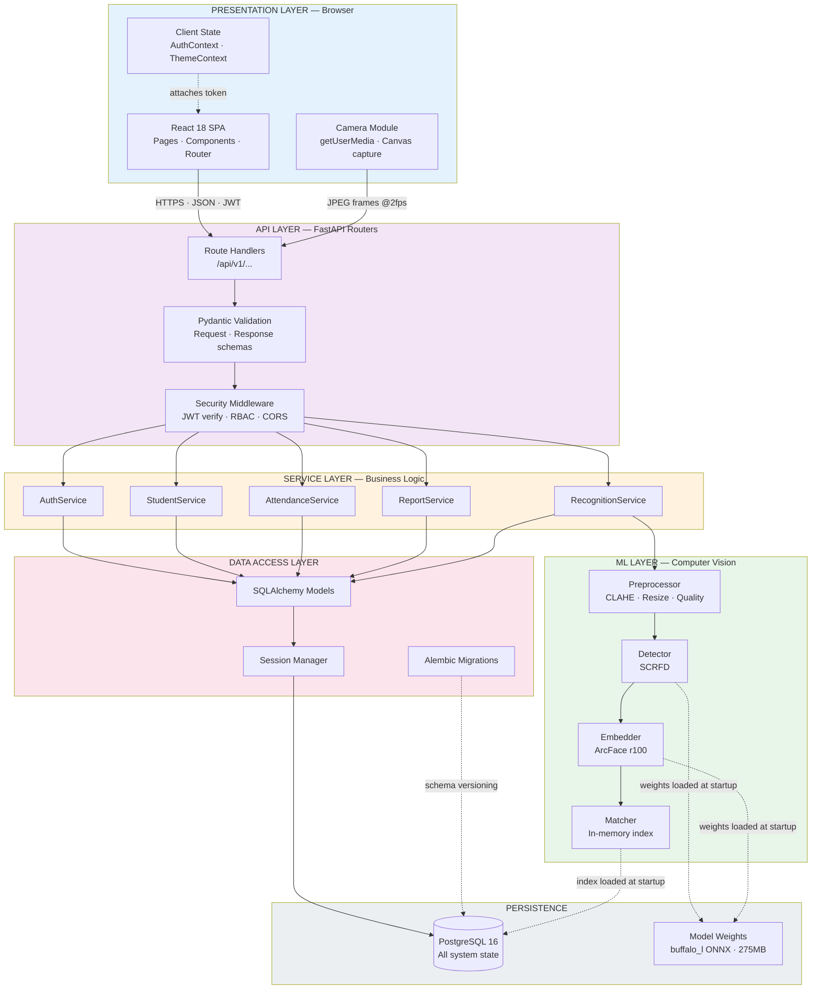

## 1.3 Thorough explanation

**Layer 1 — Presentation.** Runs entirely in the user's browser. Its only job is rendering and capturing user input. It contains *no business rules*. If you ever find yourself writing `if (user.role === 'faculty') { allowEdit() }` as your only check, you have leaked a business rule into the presentation layer — the server must independently enforce it.

The Camera Module is drawn separately from the React SPA because it has a fundamentally different data flow: it produces a continuous binary stream (JPEG frames) rather than discrete JSON requests. This distinction matters for performance tuning and for understanding where your bandwidth goes.

**Layer 2 — API.** Translates HTTP into Python function calls and back. Three sub-concerns, in strict order: routes receive the request, Pydantic validates and types it, security middleware authenticates and authorizes it. Only then does the request reach business logic.

Notice the arrow direction: `RT → VAL → SEC → Services`. Validation happens *before* authorization deliberately. A malformed request should be rejected as malformed (422) before the system spends effort deciding whether the caller is permitted to make it.

**Layer 3 — Service.** This is where your system's rules live. "A student cannot be marked twice." "Faculty may only see their own subjects." "Closing a session marks the remainder absent." These services import nothing from FastAPI — you could put a command-line interface or a gRPC server in front of them without changing a line. That property is what makes them unit-testable, and testability is the practical definition of good architecture.

**Layer 4 — ML.** A strict pipeline: preprocess → detect → embed → match. Each stage has a single input and a single output, so any stage can be swapped independently. When you upgrade from ArcFace to a newer model in two years, only `embedder.py` changes.

**Layer 5 — Data Access.** All database interaction funnels through SQLAlchemy. No service ever writes raw SQL. This is not stylistic preference — it is your SQL-injection defence (NFR-2.6), because the ORM parameterizes every query automatically.

**Layer 6 — Persistence.** PostgreSQL holds all state. The model weights sit on disk and are read once at process startup.

**The two dotted lines are the most interesting arrows in this diagram.** `Matcher ⇢ PostgreSQL` and `Detector ⇢ Disk` are both *startup-time* flows, not request-time flows. They happen once, when the server boots. Everything else happens per request. Confusing these two categories is how systems end up loading a 275 MB model on every API call.

---

# 2. Component Diagram

## 2.1 What this diagram is for

Where the architecture diagram shows *layers*, a component diagram shows *modules and their interfaces*. It answers: what are the actual code units, what does each provide, and what does each depend on?

The critical property to verify here is the **direction of dependency**. In a well-designed system, dependencies point one way only. If module A depends on B and B depends on A, you have a circular dependency — neither can be understood, tested, or changed independently.

## 2.2 The diagram

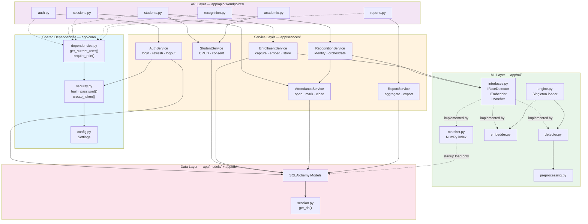

## 2.3 Thorough explanation

**Solid arrows are calls. Dotted arrows are dependency injection or implementation relationships.**

**The `interfaces.py` module is the most important box in this diagram**, and it is the one beginners omit. It defines abstract base classes — `IFaceDetector`, `IEmbedder`, `IMatcher` — that specify *what* each ML component must do without specifying *how*.

Why this matters concretely: `RecognitionService` depends on `IEmbedder`, not on `ArcFaceEmbedder`. Two consequences follow. First, in your unit tests you can inject a fake embedder that returns fixed vectors, so you can test attendance logic without loading a 275 MB model or owning a webcam — tests that would otherwise take 3 seconds each now take 3 milliseconds. Second, when you switch models, `RecognitionService` doesn't change. This is the Dependency Inversion Principle — the D in SOLID — and this diagram is where you point when an examiner asks you to name where you applied SOLID.

**`RecognitionService → AttendanceService`** is the only service-to-service call in the system, and it is deliberate. Recognition determines *who*; attendance determines *what to record*. Merging them would create a module that knows both computer vision and business rules — a violation of Single Responsibility. Keeping them separate means the `/recognition/identify` endpoint (pure recognition, no writes) and `/sessions/{id}/mark-face` (recognition plus persistence) share the same recognition code with no duplication.

**`engine.py` is a singleton**, which deserves a note because singletons are usually an anti-pattern. Here it is correct: the InsightFace model takes ~3 seconds to load and consumes ~500 MB of RAM. Loading it once at application startup and sharing the instance is the only viable design. The alternative — loading per request — would make every recognition take 3+ seconds and exhaust memory under any concurrency.

**Verify the dependency direction yourself.** Trace any path in the diagram: API → Services → ML/Data. There is no arrow from Services back up to API, and none from ML back to Services. The graph is acyclic. That is the property to check, and it is the property that will silently break first if you get sloppy during implementation.

---

# 3. ER Diagram

## 3.1 What this diagram is for

The Entity-Relationship diagram models your *problem domain* — the real-world things your system tracks and how they relate. It is drawn before any table is created, because it captures meaning rather than implementation.

Notation used below: `||` = exactly one, `o|` = zero or one, `o{` = zero or many.

## 3.2 The diagram

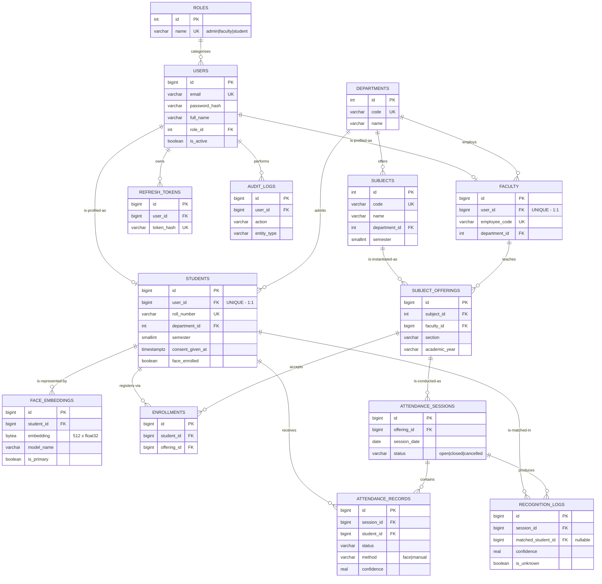

## 3.3 Thorough explanation of the relationships

### The 1:1 inheritance pattern — `USERS ↔ STUDENTS` / `FACULTY`

A user is *either* a student *or* a faculty member *or* an admin. The relationship is one-to-zero-or-one in both directions: a student row must have exactly one user, but a user may have no student row (if they are faculty).

This is the **table-per-type** pattern. The alternative — putting `roll_number`, `semester`, `employee_code`, and `designation` all in one `users` table — produces a table where most columns are NULL for most rows, which is unnormalized and gets worse with every new role.

**Why not separate login tables for students and faculty?** Because then every authentication feature — password reset, account lockout, token refresh, audit logging — must be written twice, and will inevitably drift out of sync. One `users` table means auth is written once.

### The three-way join — `SUBJECT_OFFERINGS`

This is the entity that makes the whole schema work, and the one most student projects miss.

Consider: "Data Structures" is a subject. But *who teaches it*? In section A it's Prof. Sharma; in section B it's Prof. Das. And last year both sections were taught by someone else. A subject is a *catalogue entry*; what actually gets attended is a specific **offering** — this subject, this faculty, this section, this academic year.

Three capabilities depend on this entity existing:
1. **Authorization.** "May this faculty member view these records?" resolves to "does an offering exist linking this faculty to this session?" Without offerings, that question is unanswerable and your access control collapses.
2. **Historical integrity.** Last year's attendance stays attached to last year's teacher, even after teaching assignments change.
3. **Multi-section support.** Section A and section B have separate rosters and separate sessions for the same subject.

If you link attendance directly to `subjects`, you lose all three, and you will discover this in week three when you try to write the faculty ownership check.

### The many-to-many resolution — `ENROLLMENTS`

A student takes many subjects; a subject has many students. Relational databases cannot express many-to-many directly, so it is resolved with a junction table carrying both foreign keys plus `UNIQUE (student_id, offering_id)`.

The junction table also carries its own attributes — `enrolled_at`, `is_active` — which is exactly why it must be a real entity rather than an invisible implementation detail. A student who joins mid-semester should not be counted absent for sessions before they enrolled, and `enrolled_at` is what makes that computable.

### The weak entity — `ATTENDANCE_RECORDS`

An attendance record has no independent existence: it is meaningless without its session and its student. Its identity is effectively the pair `(session_id, student_id)`, which is precisely why that pair carries a UNIQUE constraint.

We still give it a surrogate `id` primary key rather than using the composite pair as the PK. Reason: foreign keys pointing to it (from a future corrections or appeals table) stay simple, and ORM tooling handles single-column keys more cleanly.

### Nullable foreign key — `RECOGNITION_LOGS.matched_student_id`

This FK is nullable, and that nullability carries meaning: **NULL records an unknown face**. A person was detected, an embedding was computed, no student matched above threshold. That row is your unknown-person alert (Tier 2) and your evidence base for tuning the threshold. A non-nullable FK would force you to discard exactly the events you most need to study.

---

# 4. Database Schema

## 4.1 What this diagram is for

Where the ER diagram models *meaning*, the schema specifies *implementation* — exact types, constraints, defaults, and indexes. It is the direct precursor to your SQLAlchemy models.

## 4.2 Physical schema (DDL)

This is the actual PostgreSQL you will generate via Alembic. Included here so you can review the constraints before writing model code.

```sql
-- ============ IDENTITY & ACCESS ============

CREATE TABLE roles (
    id          SERIAL PRIMARY KEY,
    name        VARCHAR(20)  NOT NULL UNIQUE,
    description VARCHAR(200)
);

CREATE TABLE users (
    id                 BIGSERIAL PRIMARY KEY,
    email              VARCHAR(150) NOT NULL UNIQUE,
    password_hash      VARCHAR(255) NOT NULL,
    full_name          VARCHAR(150) NOT NULL,
    role_id            INT NOT NULL REFERENCES roles(id),
    is_active          BOOLEAN NOT NULL DEFAULT TRUE,
    failed_login_count INT NOT NULL DEFAULT 0,
    locked_until       TIMESTAMPTZ,
    last_login_at      TIMESTAMPTZ,
    created_at         TIMESTAMPTZ NOT NULL DEFAULT NOW(),
    updated_at         TIMESTAMPTZ NOT NULL DEFAULT NOW()
);
CREATE INDEX idx_users_email ON users(email);
CREATE INDEX idx_users_role  ON users(role_id) WHERE is_active = TRUE;

CREATE TABLE refresh_tokens (
    id         BIGSERIAL PRIMARY KEY,
    user_id    BIGINT NOT NULL REFERENCES users(id) ON DELETE CASCADE,
    token_hash VARCHAR(255) NOT NULL UNIQUE,
    expires_at TIMESTAMPTZ NOT NULL,
    revoked_at TIMESTAMPTZ,
    created_at TIMESTAMPTZ NOT NULL DEFAULT NOW()
);
CREATE INDEX idx_refresh_user ON refresh_tokens(user_id) WHERE revoked_at IS NULL;

-- ============ ACADEMIC STRUCTURE ============

CREATE TABLE departments (
    id   SERIAL PRIMARY KEY,
    code VARCHAR(10)  NOT NULL UNIQUE,
    name VARCHAR(100) NOT NULL UNIQUE
);

CREATE TABLE students (
    id               BIGSERIAL PRIMARY KEY,
    user_id          BIGINT NOT NULL UNIQUE REFERENCES users(id),
    roll_number      VARCHAR(30) NOT NULL UNIQUE,
    department_id    INT NOT NULL REFERENCES departments(id),
    semester         SMALLINT NOT NULL CHECK (semester BETWEEN 1 AND 8),
    phone            VARCHAR(15),
    admission_year   SMALLINT,
    consent_given_at TIMESTAMPTZ,
    face_enrolled    BOOLEAN NOT NULL DEFAULT FALSE,
    is_active        BOOLEAN NOT NULL DEFAULT TRUE,
    created_at       TIMESTAMPTZ NOT NULL DEFAULT NOW()
);
CREATE INDEX idx_students_roll     ON students(roll_number);
CREATE INDEX idx_students_dept_sem ON students(department_id, semester)
    WHERE is_active = TRUE;

CREATE TABLE faculty (
    id             BIGSERIAL PRIMARY KEY,
    user_id        BIGINT NOT NULL UNIQUE REFERENCES users(id),
    employee_code  VARCHAR(30) NOT NULL UNIQUE,
    department_id  INT NOT NULL REFERENCES departments(id),
    designation    VARCHAR(60),
    is_active      BOOLEAN NOT NULL DEFAULT TRUE
);

CREATE TABLE subjects (
    id            SERIAL PRIMARY KEY,
    code          VARCHAR(20) NOT NULL UNIQUE,
    name          VARCHAR(150) NOT NULL,
    department_id INT NOT NULL REFERENCES departments(id),
    semester      SMALLINT NOT NULL CHECK (semester BETWEEN 1 AND 8),
    credits       SMALLINT,
    is_active     BOOLEAN NOT NULL DEFAULT TRUE
);

CREATE TABLE subject_offerings (
    id            BIGSERIAL PRIMARY KEY,
    subject_id    INT NOT NULL REFERENCES subjects(id),
    faculty_id    BIGINT NOT NULL REFERENCES faculty(id),
    section       VARCHAR(10) NOT NULL DEFAULT 'A',
    academic_year VARCHAR(9)  NOT NULL,
    is_active     BOOLEAN NOT NULL DEFAULT TRUE,
    CONSTRAINT uq_offering UNIQUE (subject_id, section, academic_year)
);
CREATE INDEX idx_offerings_faculty ON subject_offerings(faculty_id)
    WHERE is_active = TRUE;

CREATE TABLE enrollments (
    id           BIGSERIAL PRIMARY KEY,
    student_id   BIGINT NOT NULL REFERENCES students(id),
    offering_id  BIGINT NOT NULL REFERENCES subject_offerings(id),
    enrolled_at  TIMESTAMPTZ NOT NULL DEFAULT NOW(),
    is_active    BOOLEAN NOT NULL DEFAULT TRUE,
    CONSTRAINT uq_enrollment UNIQUE (student_id, offering_id)
);
CREATE INDEX idx_enroll_offering ON enrollments(offering_id) WHERE is_active = TRUE;

-- ============ BIOMETRICS ============

CREATE TABLE face_embeddings (
    id            BIGSERIAL PRIMARY KEY,
    student_id    BIGINT NOT NULL REFERENCES students(id) ON DELETE CASCADE,
    embedding     BYTEA NOT NULL,                 -- 512 x float32 = 2048 bytes
    model_name    VARCHAR(50) NOT NULL,
    model_version VARCHAR(20) NOT NULL,
    quality_score REAL,
    is_primary    BOOLEAN NOT NULL DEFAULT FALSE,
    is_active     BOOLEAN NOT NULL DEFAULT TRUE,
    created_at    TIMESTAMPTZ NOT NULL DEFAULT NOW()
);
CREATE INDEX idx_emb_student ON face_embeddings(student_id)
    WHERE is_active = TRUE;
CREATE UNIQUE INDEX idx_emb_one_primary ON face_embeddings(student_id)
    WHERE is_primary = TRUE AND is_active = TRUE;

-- ============ ATTENDANCE ============

CREATE TABLE attendance_sessions (
    id           BIGSERIAL PRIMARY KEY,
    offering_id  BIGINT NOT NULL REFERENCES subject_offerings(id),
    session_date DATE NOT NULL,
    started_at   TIMESTAMPTZ NOT NULL DEFAULT NOW(),
    ended_at     TIMESTAMPTZ,
    status       VARCHAR(15) NOT NULL DEFAULT 'open'
                 CHECK (status IN ('open','closed','cancelled')),
    room         VARCHAR(30),
    created_by   BIGINT NOT NULL REFERENCES users(id)
);
CREATE INDEX idx_sessions_offering_date
    ON attendance_sessions(offering_id, session_date);
CREATE INDEX idx_sessions_open
    ON attendance_sessions(offering_id) WHERE status = 'open';

CREATE TABLE attendance_records (
    id           BIGSERIAL PRIMARY KEY,
    session_id   BIGINT NOT NULL REFERENCES attendance_sessions(id)
                 ON DELETE CASCADE,
    student_id   BIGINT NOT NULL REFERENCES students(id),
    status       VARCHAR(10) NOT NULL
                 CHECK (status IN ('present','absent','late','excused')),
    method       VARCHAR(10) NOT NULL
                 CHECK (method IN ('face','manual')),
    confidence   REAL CHECK (confidence BETWEEN 0 AND 1),
    needs_review BOOLEAN NOT NULL DEFAULT FALSE,
    marked_at    TIMESTAMPTZ NOT NULL DEFAULT NOW(),
    marked_by    BIGINT REFERENCES users(id),
    notes        VARCHAR(255),

    -- THE most important constraint in the system
    CONSTRAINT uq_attendance UNIQUE (session_id, student_id),

    -- Data integrity: face marks must carry confidence, manual marks must not
    CONSTRAINT ck_method_confidence CHECK (
        (method = 'face'   AND confidence IS NOT NULL) OR
        (method = 'manual' AND marked_by  IS NOT NULL)
    )
);
CREATE INDEX idx_records_student ON attendance_records(student_id);
CREATE INDEX idx_records_session ON attendance_records(session_id);
CREATE INDEX idx_records_review  ON attendance_records(session_id)
    WHERE needs_review = TRUE;

-- ============ OBSERVABILITY ============

CREATE TABLE recognition_logs (
    id                 BIGSERIAL PRIMARY KEY,
    session_id         BIGINT REFERENCES attendance_sessions(id),
    matched_student_id BIGINT REFERENCES students(id),   -- NULL = unknown face
    confidence         REAL,
    is_unknown         BOOLEAN NOT NULL DEFAULT FALSE,
    processing_ms      INT,
    captured_at        TIMESTAMPTZ NOT NULL DEFAULT NOW()
);
CREATE INDEX idx_reclog_session ON recognition_logs(session_id);
CREATE INDEX idx_reclog_unknown ON recognition_logs(captured_at)
    WHERE is_unknown = TRUE;

CREATE TABLE audit_logs (
    id          BIGSERIAL PRIMARY KEY,
    user_id     BIGINT REFERENCES users(id),
    action      VARCHAR(50) NOT NULL,
    entity_type VARCHAR(50) NOT NULL,
    entity_id   BIGINT,
    details     JSONB,
    ip_address  VARCHAR(45),
    created_at  TIMESTAMPTZ NOT NULL DEFAULT NOW()
);
CREATE INDEX idx_audit_entity ON audit_logs(entity_type, entity_id);
CREATE INDEX idx_audit_time   ON audit_logs(created_at DESC);
```

## 4.3 Schema decisions worth defending

**Partial indexes** (`WHERE is_active = TRUE`) appear throughout. Because we soft-delete, deactivated rows accumulate forever, but queries almost always want only active rows. A partial index covers only those rows — smaller, faster, and cheaper to maintain on write. This is a genuinely professional touch that few student projects include.

**`idx_emb_one_primary`** is a *unique partial index*, and it encodes a business rule the naive schema cannot: a student may have many embeddings, but at most one marked primary. Expressing that as a database constraint rather than application logic means it cannot be violated by a bug.

**`ck_method_confidence`** is a CHECK constraint enforcing cross-column consistency: a face-marked record must carry a confidence score; a manually-marked record must record who marked it. This makes malformed data *impossible* rather than merely unlikely.

**`ON DELETE CASCADE` on `face_embeddings`** implements the right-to-erasure requirement (NFR-3.4) at the database level. Deleting a student removes their biometric data automatically. Note that `attendance_records` deliberately does **not** cascade from students — we soft-delete students precisely so history survives.

**`TIMESTAMPTZ` everywhere, never `TIMESTAMP`.** `TIMESTAMPTZ` stores an absolute moment; `TIMESTAMP` stores a wall-clock reading with no timezone, which is ambiguous. Store UTC, convert to IST at the presentation layer. Getting this wrong produces attendance records dated to the wrong day around midnight — a bug that is miserable to diagnose after the fact.

---

# 5. DFD Level 0

## 5.1 What this diagram is for

The context diagram defines the **system boundary**. It shows the entire system as a single process (numbered 0) and identifies every external entity that exchanges data with it.

**The most common mistake:** putting the database on the context diagram. The database is *inside* your system, not external to it. External entities are things you do not control — people and other systems.

## 5.2 The diagram

```
                              ┌───────────────────┐
                              │                   │
                              │      ADMIN        │
                              │                   │
                              └─────────┬─────────┘
                                        │
        student/faculty/subject data,   │   ▲  confirmations,
        enrollment lists, credentials   │   │  analytics, audit views
                                        ▼   │
   ┌──────────────────┐      ┌──────────────────────────┐      ┌──────────────────┐
   │                  │      │                          │      │                  │
   │                  │─────▶│                          │─────▶│                  │
   │     FACULTY      │      │           0              │      │     STUDENT      │
   │                  │◀─────│                          │◀─────│                  │
   │                  │      │   AI ATTENDANCE          │      │                  │
   └──────────────────┘      │   MANAGEMENT SYSTEM      │      └──────────────────┘
                             │                          │
   OUT: credentials,         │                          │      OUT: credentials
        session commands,    └────────┬─────────────────┘
        camera frames,                │        ▲              IN:  attendance %,
        manual corrections            │        │                   subject breakdown,
                                      ▼        │                   history,
   IN:  live recognition       face crops   identity +             low-attendance
        results, rosters,      (aligned)    confidence             warnings
        attendance tables,           │        │
        CSV exports                  ▼        │
                             ┌──────────────────────────┐
                             │   RECOGNITION ENGINE     │
                             │   (InsightFace / ONNX)   │
                             └──────────────────────────┘
```

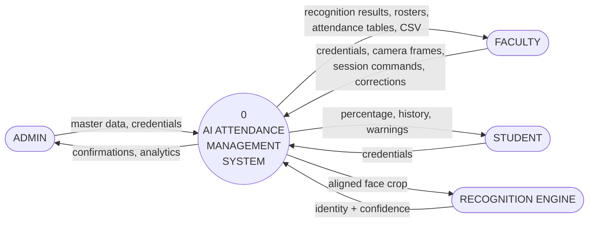

## 5.3 Thorough explanation

**Four external entities, no more.** Admin, Faculty, and Student are human actors. The Recognition Engine is a distinct external entity because it is third-party software (InsightFace) with its own defined interface — we send it images and receive identities, but we did not write it and cannot change its behaviour.

**Every arrow is labelled with data, not actions.** "Camera frames" is data; "takes attendance" is not. This is the rule that distinguishes a DFD from a flowchart, and it is where marks are commonly lost. A DFD shows *what information moves*, never *what order things happen in* — there is no sequencing implied anywhere in this diagram.

**Notice what is absent:** no PostgreSQL, no FastAPI, no React. The context diagram is deliberately technology-agnostic. You could reimplement this system in Java with MySQL and this diagram would be unchanged, because it describes the problem rather than the solution.

**Reading the Faculty flows** tells you why Faculty is the heaviest actor: they are the only entity with a continuous, high-volume data flow (camera frames at 2 fps). That observation directly justifies the performance requirements in NFR-1 — it identifies where your system's load actually comes from.

---

# 6. DFD Level 1

## 6.1 What this diagram is for

Level 1 explodes process 0 into its constituent processes and — crucially — reveals the **data stores** that were hidden inside the boundary at Level 0.

Numbering convention: processes at Level 1 are 1.0 through 6.0; data stores are D1 through D5.

## 6.2 The diagram

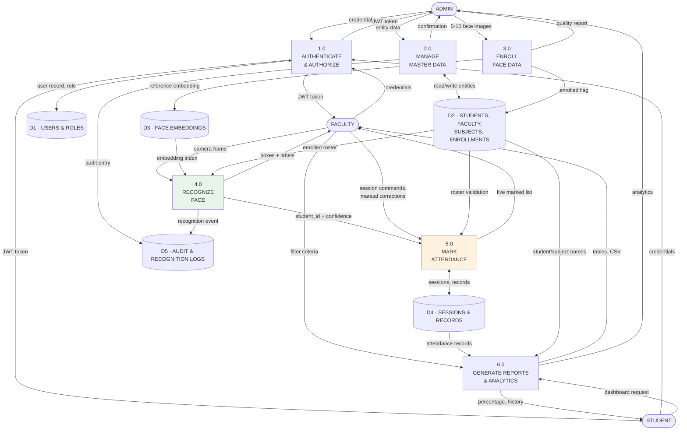

## 6.3 Process specifications

| Process | Inputs | Transformation | Outputs | Stores |
|---------|--------|----------------|---------|--------|
| **1.0 Authenticate & Authorize** | Email, password, or bearer token | Verify bcrypt hash; check `is_active` and lockout; issue signed JWT carrying role claim; on later calls, verify signature and check role against endpoint requirement | JWT access + refresh tokens; allow/deny decision | D1 R/W |
| **2.0 Manage Master Data** | Entity payloads (student, faculty, subject, offering, enrollment) | Validate against schema; enforce uniqueness of roll number / email / subject code; soft-delete rather than remove; write audit entry | Created/updated entities; confirmations | D2 W, D5 W |
| **3.0 Enroll Face Data** | 5–15 images, student ID, consent flag | Detect → require exactly one face → quality gate → align to 112×112 → embed → L2 normalize → verify intra-set similarity → average → normalize → store; **delete raw images** | Reference embedding; quality score; enrollment status | D3 W, D2 W |
| **4.0 Recognize Face** | JPEG frame, session ID | Decode → CLAHE → detect all faces → per face: quality gate, align, embed, normalize → matrix-multiply against roster-filtered index → argmax → three-band threshold | Per-face: student ID + confidence, or UNKNOWN; bounding boxes | D3 R, D2 R, D5 W |
| **5.0 Mark Attendance** | Student ID, session ID, confidence, or manual command | Verify session is open; verify student enrolled in this offering; attempt insert, catch unique violation; on close, insert `absent` for all unmarked enrolled students | Attendance records; live marked list | D4 R/W, D2 R |
| **6.0 Reports & Analytics** | Filter criteria (offering, date range, student) | Join records with sessions and students; aggregate counts by status; compute percentage over closed sessions; flag below threshold; serialize to CSV/PDF | Dashboards, tables, exports, charts | D4 R, D2 R |

## 6.4 Thorough explanation

**Process 4.0 and 5.0 are drawn separately, and the arrow between them carries only `student_id + confidence`.** This is the diagrammatic expression of the architectural decision in §2.3: recognition determines *who*, attendance determines *what to record*. The narrow interface between them is what allows `/recognition/identify` to exist as a read-only endpoint.

**D3 flows into 4.0 but not out of it.** Recognition only *reads* embeddings; it never writes them. Only enrollment (3.0) writes to D3. This read/write asymmetry is worth stating explicitly, because it is a security property: a compromised recognition endpoint cannot poison your biometric reference data.

**The `D2 → 4.0` arrow labelled "enrolled roster"** is easy to overlook but carries real weight. It is what implements search-space reduction — recognition searches only students enrolled in *this offering*, roughly 40–60 people rather than 1,000. That arrow is simultaneously a performance optimization and a false-positive mitigation.

**Every process writes to D5 except 6.0.** Reporting is purely read-only. Any process that changes state leaves an audit trail; any process that only reads does not. That is a clean, defensible rule.

---

# 7. Use Case Diagram

## 7.1 What this diagram is for

The use case diagram shows *who can do what*. It is the bridge between requirements and design, and it is the natural place to demonstrate that your role-based access control is coherent.

## 7.2 The diagram

```mermaid
graph TB
    ADMIN(["👤 ADMIN"])
    FAC(["👤 FACULTY"])
    STU(["👤 STUDENT"])
    ENG(["⚙️ RECOGNITION ENGINE"])

    subgraph SYSTEM["AI ATTENDANCE MANAGEMENT SYSTEM"]
        subgraph AUTHG["Authentication"]
            U1["UC-01 Log In"]
            U2["UC-02 Log Out"]
        end

        subgraph ADMING["Administration"]
            U3["UC-03 Register Student"]
            U4["UC-04 Enroll Face Data"]
            U5["UC-05 Update Student"]
            U6["UC-06 Deactivate Student"]
            U7["UC-07 Manage Faculty"]
            U8["UC-08 Manage Subjects"]
            U9["UC-09 Assign Faculty to Subject"]
            U10["UC-10 Enroll Students in Subject"]
            U11["UC-11 View System Analytics"]
        end

        subgraph FACG["Attendance Operations"]
            U12["UC-12 Open Session"]
            U13["UC-13 Mark via Face Recognition"]
            U14["UC-14 Mark Manually"]
            U15["UC-15 Correct Record"]
            U16["UC-16 Close Session"]
            U17["UC-17 View Attendance"]
            U18["UC-18 Filter and Search"]
            U19["UC-19 Export CSV"]
        end

        subgraph STUG["Student Self-Service"]
            U20["UC-20 View Own Summary"]
            U21["UC-21 View Own History"]
            U22["UC-22 View Low-Attendance Warning"]
        end
    end

    ADMIN --> U1
    ADMIN --> U3
    ADMIN --> U4
    ADMIN --> U5
    ADMIN --> U6
    ADMIN --> U7
    ADMIN --> U8
    ADMIN --> U9
    ADMIN --> U10
    ADMIN --> U11
    ADMIN --> U19

    FAC --> U1
    FAC --> U12
    FAC --> U13
    FAC --> U14
    FAC --> U15
    FAC --> U16
    FAC --> U17
    FAC --> U18
    FAC --> U19

    STU --> U1
    STU --> U20
    STU --> U21
    STU --> U22

    U4 -.->|"«include»"| ENG
    U13 -.->|"«include»"| ENG
    U13 -.->|"«extend»"| U14
    U3 -.->|"«include»"| U1
    U13 -.->|"«include»"| U12
    U20 -.->|"«extend»"| U22

    style AUTHG fill:#e1f5fe
    style ADMING fill:#f3e5f5
    style FACG fill:#fff3e0
    style STUG fill:#e8f5e9
```

## 7.3 Thorough explanation

**The `«include»` and `«extend»` relationships are where marks are won or lost**, because they are frequently confused.

- **`«include»` = mandatory.** The included use case *always* happens as part of the base. UC-13 includes UC-12, because you cannot mark attendance without an open session. UC-13 includes the Recognition Engine, because face marking always invokes it.
- **`«extend»` = optional/conditional.** UC-13 extends to UC-14 (manual marking) *only when* recognition fails or the camera is unavailable. UC-20 extends to UC-22 *only when* the student falls below threshold.

Getting these backwards is the single most common error in use case diagrams. The test: ask "does this always happen?" Always → include. Sometimes → extend.

**The grouping reveals your authorization model.** Each shaded group maps to exactly one role, with two deliberate exceptions:

1. **UC-19 (Export CSV)** is shared between Admin and Faculty. Faculty export their own subjects; Admin exports anything. Same use case, different data scope — enforced in the service layer, not by having two separate use cases.
2. **UC-01 (Log In)** is universal.

**What is deliberately absent is as informative as what is present.** No arrow runs from Student to any UC-1x. Students cannot view other students' data, cannot open sessions, cannot correct records. That absence *is* the security model, expressed diagrammatically. When an examiner asks how you prevent a student from marking themselves present, this diagram is the first half of your answer and the server-side `require_role` dependency is the second.

**The Recognition Engine appears as an actor, not a use case.** It is a secondary actor — it does not initiate anything, it responds. Drawing it on the right side of the system boundary (conventional for secondary actors) makes this immediately readable.

---

# 8. Sequence Diagram — Attendance Marking

## 8.1 What this diagram is for

This is the diagram that proves you understand your own system. Where the architecture diagram shows structure, a sequence diagram shows **behaviour over time** — the exact ordered exchange of messages between components for one specific scenario.

UC-13 is the core use case, so it gets the full treatment: main flow plus all significant alternate flows.

## 8.2 Main flow with alternates

```mermaid
sequenceDiagram
    autonumber
    actor F as Faculty
    participant UI as React SPA
    participant CAM as Camera Module
    participant API as FastAPI Router
    participant SEC as Auth Dependency
    participant RS as RecognitionService
    participant ML as ML Pipeline
    participant IDX as In-Memory Index
    participant ATS as AttendanceService
    participant DB as PostgreSQL

    Note over F,DB: PHASE 1 — SESSION SETUP

    F->>UI: Select offering, click "Open Session"
    UI->>API: POST /api/v1/sessions {offering_id}
    API->>SEC: verify JWT, require_role("faculty")
    SEC->>DB: SELECT user, role
    DB-->>SEC: user record
    SEC-->>API: authorized (user_id)
    API->>ATS: open_session(offering_id, user_id)
    ATS->>DB: SELECT offering WHERE id AND faculty_id=user
    alt Faculty does not own this offering
        DB-->>ATS: no rows
        ATS-->>API: PermissionError
        API-->>UI: 403 Forbidden
        UI-->>F: "You do not teach this subject"
    else Ownership confirmed
        DB-->>ATS: offering record
        ATS->>DB: INSERT attendance_sessions (status='open')
        DB-->>ATS: session_id
        ATS-->>API: session object
        API-->>UI: 201 Created {session_id, roster}
        UI-->>F: Session open, roster displayed
    end

    Note over F,DB: PHASE 2 — CAMERA START

    F->>UI: Click "Start Camera"
    UI->>CAM: requestCamera()
    CAM->>CAM: navigator.mediaDevices.getUserMedia()
    alt Permission denied or no secure context
        CAM-->>UI: NotAllowedError
        UI-->>F: Fall back to manual marking (UC-14)
    else Permission granted
        CAM-->>UI: MediaStream
        UI-->>F: Live video displayed
    end

    Note over F,DB: PHASE 3 — RECOGNITION LOOP (repeats at 2 fps)

    loop Every 500 ms while session open
        CAM->>CAM: Draw video frame to canvas
        CAM->>CAM: canvas.toBlob("image/jpeg", 0.8)
        CAM->>API: POST /sessions/{id}/mark-face (multipart JPEG)
        API->>SEC: verify JWT
        SEC-->>API: authorized
        API->>RS: identify_and_mark(frame, session_id)

        RS->>ML: preprocess(frame)
        ML->>ML: resize to 640px, CLAHE on L channel
        ML->>ML: SCRFD detect faces

        alt No face detected
            ML-->>RS: []
            RS-->>API: {faces: []}
            API-->>UI: 200 {faces: []}
            Note over UI: Silently ignored, no flicker
        else Faces detected
            ML-->>RS: [(bbox, score, landmarks), ...]

            loop For each detected face
                RS->>ML: quality_gate(face)
                alt Face too small, blurry, or low score
                    ML-->>RS: REJECTED
                    Note over RS: Skip this face silently
                else Quality acceptable
                    ML->>ML: align to 112x112 via landmarks
                    ML->>ML: normalize pixels to [-1, 1]
                    ML->>ML: ArcFace embed to 512-d
                    ML->>ML: L2 normalize
                    ML-->>RS: query_embedding

                    RS->>IDX: search(embedding, roster_filter)
                    IDX->>IDX: similarities = matrix @ query
                    IDX->>IDX: best = argmax(similarities)
                    IDX-->>RS: (student_id, similarity)

                    alt similarity < 0.40 — UNKNOWN
                        RS->>DB: INSERT recognition_logs (is_unknown=true)
                        RS-->>API: {label: "Unknown", bbox}
                    else similarity >= 0.40 — MATCH
                        RS->>DB: INSERT recognition_logs (student_id, confidence)
                        RS->>ATS: mark_present(session_id, student_id, confidence)
                        ATS->>DB: SELECT enrollment WHERE student AND offering

                        alt Student not enrolled in this offering
                            DB-->>ATS: no rows
                            ATS-->>RS: NotEnrolledError
                            RS-->>API: {label: "Not enrolled", bbox}
                        else Enrolled
                            ATS->>DB: INSERT attendance_records<br/>(session, student, 'present', 'face', confidence)

                            alt UNIQUE violation — already marked
                                DB-->>ATS: IntegrityError
                                ATS->>DB: SELECT existing record
                                DB-->>ATS: existing record
                                ATS-->>RS: already_marked (idempotent)
                            else Insert succeeded
                                DB-->>ATS: new record_id
                                ATS-->>RS: marked
                            end
                            RS-->>API: {student, confidence, bbox, status}
                        end
                    end
                end
            end
            API-->>UI: 200 {faces: [...]}
            UI->>UI: Draw bounding boxes + name + confidence
            UI->>UI: Append to "Marked Present" list
            UI-->>F: Live visual feedback
        end
    end

    Note over F,DB: PHASE 4 — SESSION CLOSE

    F->>UI: Click "Close Session"
    UI->>API: POST /sessions/{id}/close
    API->>ATS: close_session(session_id, user_id)
    ATS->>DB: SELECT enrolled students WITHOUT a record
    DB-->>ATS: unmarked student list
    ATS->>DB: BULK INSERT attendance_records<br/>(status='absent', method='manual')
    ATS->>DB: UPDATE session SET status='closed', ended_at=NOW()
    DB-->>ATS: committed
    ATS-->>API: session summary
    API-->>UI: 200 {present: 38, absent: 4, review: 2}
    UI-->>F: Final summary displayed
```

## 8.3 Thorough explanation

**Phase 1 demonstrates defence in depth.** Authorization is checked twice, at two different levels of specificity. `SEC` verifies the caller *is a faculty member* (role check). `ATS` then verifies the caller *teaches this specific offering* (ownership check). The first is coarse-grained RBAC; the second prevents horizontal privilege escalation — one faculty member accessing another's class. Systems that implement only the first check are vulnerable, and that vulnerability class (IDOR — Insecure Direct Object Reference) is one of the most common real-world API flaws.

**Phase 2's alternate flow is a real risk, not a hypothetical.** `getUserMedia` fails outside a secure context. It works on `http://localhost` but *fails* on `http://192.168.1.x`. The alternate branch is not defensive padding — it is the flow that will actually execute if you demo from a phone. Building the manual fallback is what turns a demo-day catastrophe into a minor inconvenience.

**Phase 3 contains six nested decision points**, and each one exists for a specific reason:

| Decision | Purpose |
|----------|---------|
| No face detected | Silent skip — at 2 fps, showing an error would strobe |
| Quality gate rejection | Prevents low-information faces producing *wrong-person* matches |
| Similarity threshold | The core accept/reject decision |
| Enrollment check | A student from another section must not be marked into this class |
| UNIQUE violation | Duplicate prevention, race-safe |
| (implicit) grey band | Confidence 0.40–0.50 sets `needs_review` for human confirmation |

**The `alt UNIQUE violation` branch is the most important six lines in this document.** Note carefully what it does *not* do: it does not treat the collision as an error. The student is already marked; the desired end state is achieved; the operation returns success. This makes `mark-face` **idempotent** — calling it repeatedly with the same student produces the same result as calling it once.

This matters enormously at 2 fps. A student standing in frame for ten seconds generates twenty identical recognition events. Without idempotency, nineteen of them are errors that must be handled, logged, and suppressed in the UI. With idempotency, they are simply no-ops. Designing for idempotency is one of the clearest markers separating a system built by someone who has operated software from one built by someone who has only written it.

**Phase 4 shows why absence is computed, not observed.** You cannot detect a student who is not there. Absence is derived: *enrolled students minus marked students*. This is a set-difference operation, executed once at close, in a single bulk insert rather than a loop. Note that these auto-absent records carry `method='manual'` — because no face was recognized, so a confidence score would be meaningless.

## 8.4 Compact enrollment sequence (UC-04)

Included for comparison — note how the same ML pipeline is reused with different rules.

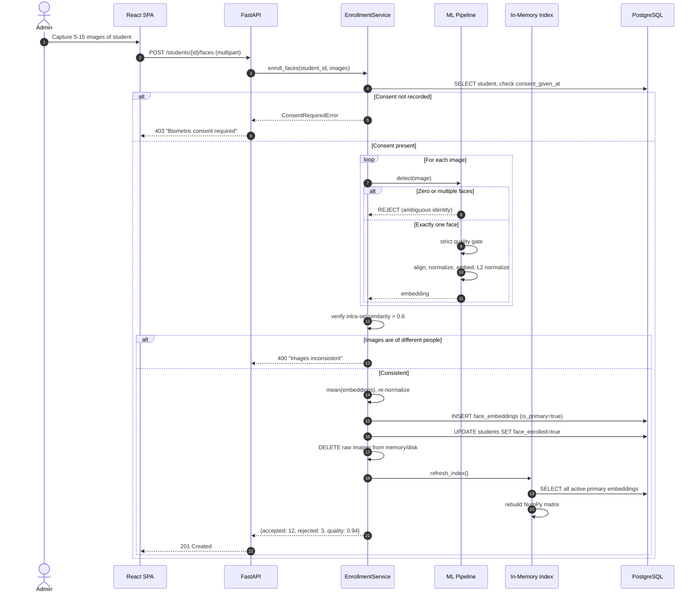

**Three differences from recognition worth noting:** enrollment requires *exactly one* face (recognition allows many); enrollment applies a *stricter* quality gate (bad reference data poisons every future match); and enrollment triggers an index rebuild, which recognition never does.

---

# 9. Deployment Diagram

## 9.1 What this diagram is for

A deployment diagram maps *software artifacts* onto *physical or virtual nodes*. It answers: what actually runs where, and how do the machines talk to each other?

Three deployment topologies are presented, because your system will pass through all three: demo, pilot, and production. Showing this progression is exactly how you demonstrate that the design is built for growth rather than merely claimed to be.

## 9.2 Topology A — Development & Demo (single machine)

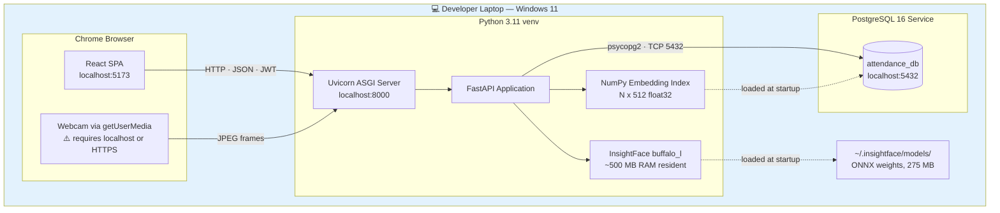

**Characteristics:** everything on one machine, ~1.5 GB RAM, no network configuration. This is your demo topology. **Its defining constraint is that the camera works only because the origin is `localhost`.**

## 9.3 Topology B — Institutional Pilot (LAN)

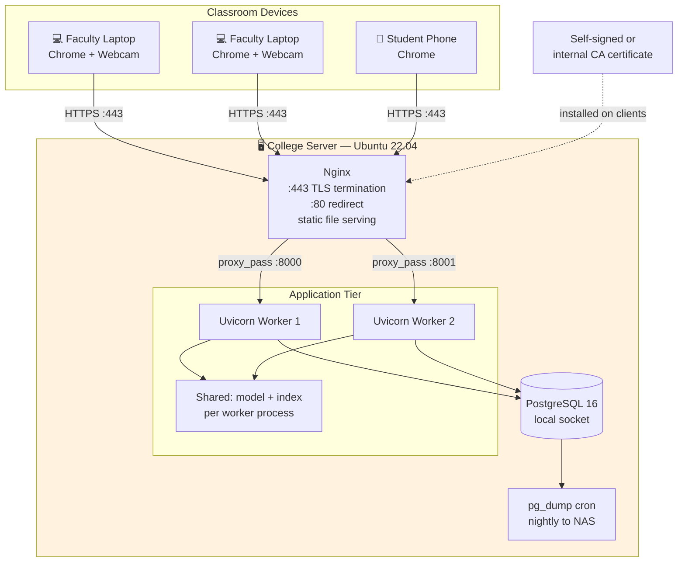

**What changed and why:**

- **Nginx with TLS is now mandatory, not optional.** Clients are on `192.168.x.x`, not `localhost`, so `getUserMedia` requires HTTPS. This is R-2 from the risk register, materialising exactly as predicted. Nginx also serves the built React bundle as static files, which it does far more efficiently than Python.
- **Multiple Uvicorn workers** provide concurrency for multiple simultaneous classes. Note the caveat: each worker loads its own copy of the model (~500 MB each), so worker count is bounded by RAM, not CPU.
- **Nightly `pg_dump`** — the first time this system holds data anyone actually cares about, backups stop being optional.

**⚠️ The critical constraint at this tier:** the in-memory index is *per-worker*. Enrolling a student refreshes the index in whichever worker handled that request — the other worker keeps a stale index and will not recognize the new student. **This is a real correctness bug, and it appears the moment you run more than one worker.** It is solved in Topology C.

## 9.4 Topology C — Production / Commercial (cloud)

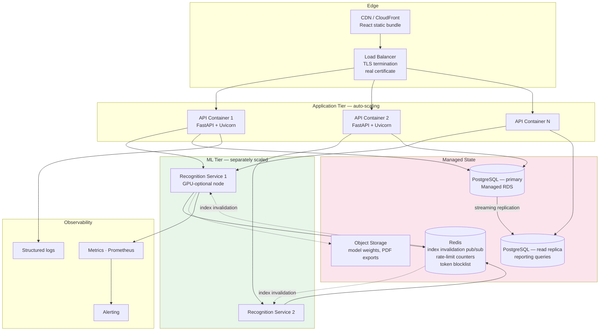

**What changed and why:**

- **The ML tier is now a separate service.** This is the seam identified back in the architecture decision (D-01) — the modular monolith's ML layer, extracted. Recognition is CPU-hungry and benefits from GPU nodes; CRUD endpoints do not. Scaling them independently means paying for expensive compute only where it is needed. **Because the ML layer already sits behind `interfaces.py`, this extraction requires no change to business logic** — which is precisely the payoff for the discipline maintained in the component design.
- **Redis pub/sub solves the stale index bug.** When a student is enrolled, a message is published; every recognition node refreshes. This is the documented fix for Topology B's known defect.
- **A read replica** handles reporting and analytics. Dashboard queries aggregate across thousands of records and would otherwise compete with attendance writes for the same connections.
- **Object storage** for model weights means new containers pull weights on boot rather than baking a 275 MB file into every image.
- **Observability** becomes non-negotiable: when you cannot SSH into the machine to look, structured logs and metrics are the only way to know what happened.

## 9.5 Migration path

| Change | A → B | B → C |
|--------|-------|-------|
| Application code | None | Extract ML layer behind HTTP; add Redis client |
| Database schema | None | None |
| Configuration | `.env` values only | `.env` + service discovery |
| Frontend | Rebuild with new API URL | Rebuild with new API URL |

**The important row is "Database schema: None, None."** Because the schema was designed once, correctly, with offerings, soft deletion, and model versioning already in place, growing from a laptop to a cloud deployment requires no migration. That is what "designed for commercialization" means concretely — not that you built cloud infrastructure now, but that nothing you built now *prevents* it later.

---

# 10. Production Readiness Audit

You asked me to verify the design is scalable and production-ready. An honest answer requires distinguishing three different claims, because they have three different answers.

## 10.1 Verdict summary

| Claim | Verdict |
|-------|---------|
| Is the **design** sound and scalable? | ✅ **Yes** — with the caveats in §10.3 |
| Is it **production-ready as a college project**? | ✅ **Yes** — this exceeds the bar comfortably |
| Would it be **production-ready as a commercial product today**? | ❌ **No** — and it should not claim to be. §10.4 lists exactly what is missing |

Claiming the third would be the wrong answer, and an experienced examiner will probe it. The strong position is: *"the architecture is production-grade; the deployment and operational maturity are deliberately scoped to a pilot, and here is the specific gap list."*

## 10.2 Scalability analysis — where the ceilings actually are

| Component | Current limit | First bottleneck | Fix when reached |
|-----------|--------------|------------------|------------------|
| **Embedding search** | ~50,000 students | Linear scan becomes >50 ms | pgvector + HNSW index (approximate NN) |
| **Face inference (CPU)** | ~6 faces/sec/worker | ~150 ms per face, CPU-bound | GPU node (10–20× faster) or more ML replicas |
| **API throughput** | ~50 concurrent users | Uvicorn worker count | Horizontal scale — stateless by design (NFR-5.5) |
| **PostgreSQL writes** | ~5,000 records/day trivially | Not a bottleneck at institutional scale | Connection pooling (PgBouncer), then partitioning by year |
| **Reporting queries** | ~1M records | Full-table aggregation | Read replica, then materialized views |
| **Frame bandwidth** | ~30 KB × 2/sec/client | ~50 concurrent cameras on a LAN | Client-side face cropping before upload |

**The honest headline:** for the stated target of 1,000 students and 50 concurrent users, **every component has substantial headroom**. The design is not merely adequate at that scale, it is over-provisioned — deliberately, because the cost of the right structure now is near zero and the cost of retrofitting it later is enormous.

**The first thing that actually breaks under growth** is not the database and not the API — it is CPU inference throughput. At ~6 faces/second/worker, a 500-student assembly hall would take 80+ seconds. That is the number to quote when asked about limits, and the answer is that the ML tier scales independently precisely because it was designed as a separable component.

## 10.3 Design strengths (what genuinely holds up)

| Area | Assessment |
|------|-----------|
| **Separation of concerns** | ✅ Strict layering, dependencies acyclic, ML behind interfaces. This is the property that makes everything else possible. |
| **Data integrity** | ✅ Constraints in the database, not just application code. The UNIQUE constraint, the CHECK constraints, and the unique partial index make invalid states unrepresentable. |
| **Idempotency** | ✅ `mark-face` is safely repeatable — essential for a 2 fps stream, and frequently missed. |
| **Statelessness** | ✅ JWT-based auth with no server-side session state means the API tier scales horizontally without sticky sessions. |
| **Schema stability** | ✅ Offerings, soft deletion, and model versioning mean no migration is needed to reach cloud deployment. |
| **Security fundamentals** | ✅ bcrypt, hashed refresh tokens, server-side authorization, ORM-parameterized queries, embeddings never leaving the server. |
| **Privacy posture** | ✅ Consent recorded, raw images deleted, erasure supported via CASCADE. Ahead of most commercial systems in this category. |
| **Graceful degradation** | ✅ Manual marking always available. The system never becomes unusable because a camera or model failed. |
| **Observability foundations** | ✅ `recognition_logs` provides the data to measure accuracy empirically rather than assert it. |

## 10.4 Gaps — what is genuinely missing for commercial production

These are honest omissions, not oversights. Each is deliberately deferred, and being able to name them precisely is stronger than pretending they do not exist.

| # | Gap | Severity | Why deferred | Fix |
|---|-----|----------|--------------|-----|
| G-1 | **No TLS in Topology A** | 🔴 High | Demo runs on localhost | Mandatory from Topology B — already in the design |
| G-2 | **Stale index across multiple workers** | 🔴 High | Single worker in demo | Redis pub/sub invalidation (Topology C) |
| G-3 | **No rate limiting** | 🟠 Medium | No hostile traffic in a pilot | `slowapi` middleware; ~10 lines |
| G-4 | **No automated backups in Topology A** | 🔴 High | Demo data is disposable | `pg_dump` cron from Topology B |
| G-5 | **No liveness/anti-spoofing in Tier 1** | 🟠 Medium | Faculty are physically present | Passive texture analysis; Tier 2 item |
| G-6 | **No automated test suite** | 🟠 Medium | 3-week timeline; manual testing only | pytest + fixtures; the service layer is already testable by design |
| G-7 | **No CI/CD pipeline** | 🟡 Low | Solo developer, manual deploy | GitHub Actions |
| G-8 | **No structured logging or metrics** | 🟠 Medium | Console logs suffice at pilot scale | `structlog` + Prometheus |
| G-9 | **No load testing performed** | 🟠 Medium | Performance targets are estimates, unverified | Locust; even one run produces real numbers for your report |
| G-10 | **Single points of failure** | 🟡 Low | Acceptable for a pilot | Redundancy in Topology C |
| G-11 | **No accuracy measurement across demographics** | 🔴 High | Requires real test data | **Do this — see below** |
| G-12 | **Threshold not yet calibrated** | 🔴 High | Requires collected data | Task 5.4 in the roadmap |

**G-11 and G-12 are the two you should actually close during this project**, because unlike the others they are cheap and they directly improve your grade. Both need only the data you will naturally generate while testing:

- **G-12** is Task 5.4 — collect ~200 recognition attempts with known ground truth, plot genuine vs impostor similarity distributions, choose the separating threshold, present the ROC curve. This converts "we used 0.5" into an experimental result.
- **G-11** is the same data, segmented. Report accuracy across the demographic range of your actual test subjects. Face recognition accuracy differences across skin tone, gender, and age are documented at scale in NIST's FRVT Part 3 evaluations; measuring whether your system exhibits them, and saying so plainly, is a genuine limitations section. Examiners reward students who find flaws in their own work far more than students who claim perfection.

## 10.5 Final verification statement

> **The architecture is sound.** Layering is strict and dependencies are acyclic; business logic is isolated and testable; the ML layer sits behind interfaces that permit both model replacement and service extraction without touching business code.
>
> **The data model is correct.** It is normalized to 3NF, business rules are enforced by database constraints rather than by convention, and it requires no migration to reach cloud deployment.
>
> **The scaling path is real, not aspirational.** Each growth stage has an identified bottleneck and a specific, known fix. The stateless API tier, the separable ML tier, and the pgvector upgrade path are all enabled by decisions already made.
>
> **The gaps are known and enumerated.** Twelve items are listed with severity and remediation. None is an architectural flaw; all are operational maturity items appropriate to defer at pilot scale.
>
> **Verdict: approved for implementation.** This design is production-grade in structure and pilot-grade in operations, which is exactly the correct target for a three-week build intended to scale later.

---

*End of Diagram Pack v1.0 — proceed to Task 1.1*
