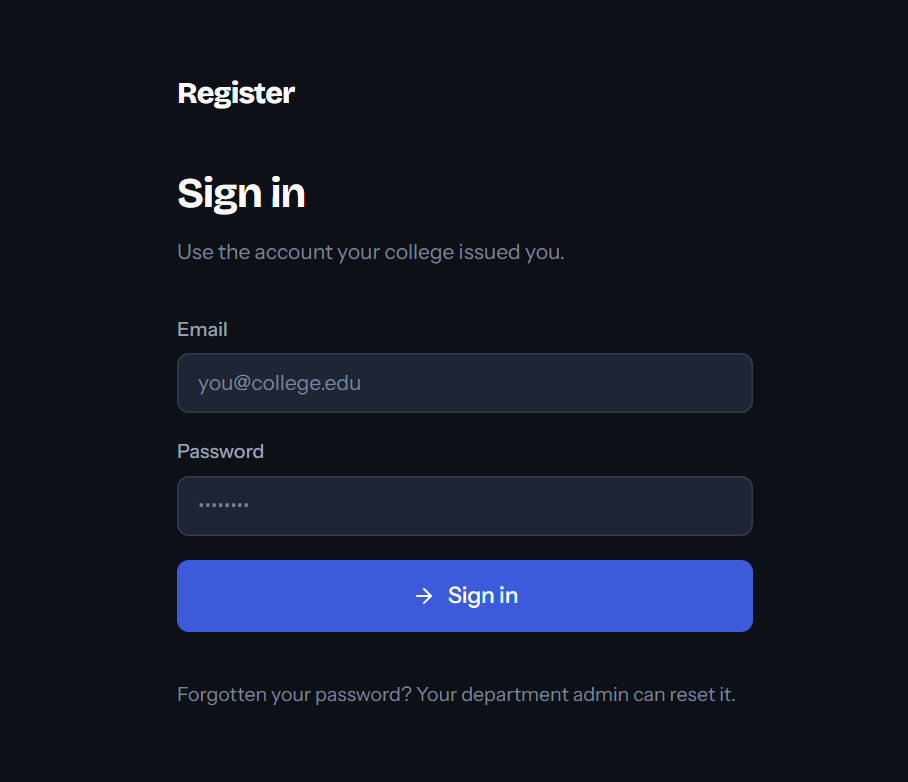
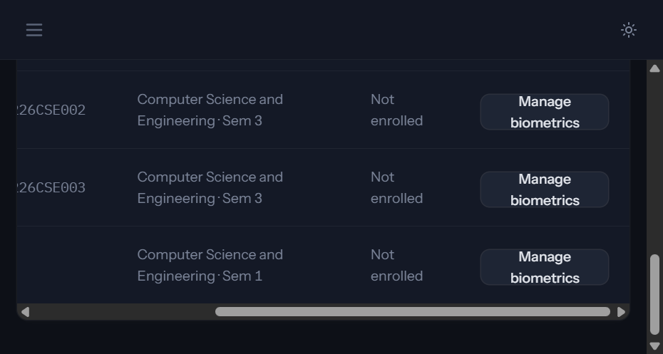

# Smart Attendance

Smart Attendance is a full-stack attendance platform for colleges. Faculty can
open class sessions, mark students manually or with face recognition, and
review attendance analytics. Administrators can manage students, biometric
consent, and face-enrollment data from the web application.

The project keeps structured data in SQLAlchemy and supports SQLite for local
development. Face enrollment stores an averaged embedding, not the raw
enrollment images. Profile-photo storage, when configured, is handled
separately through Cloudinary.

## Features

- JWT access and refresh-token authentication with role-based access control.
- Faculty dashboard for classes and attendance sessions.
- Manual attendance states: present, late, absent, and excused.
- Camera-based face detection, matching, roster restriction, and duplicate-safe
  attendance marking.
- Administrative Student List with search, registration, validation, and
  duplicate identifier checks.
- Explicit biometric consent, revocation, enrollment-status reporting, and
  5–15 image face enrollment.
- Attendance analytics and reports backed by database records.
- SQLite-compatible schema management and Alembic migrations.

## Screenshots

These screenshots were captured from the running application. The local
authentication session had expired when the attendance screenshot was
requested, so the login and Student List views are included here.





## Technology stack

- **Frontend:** React 18, Vite, React Router, Axios, Tailwind CSS, Lucide,
  Chart.js.
- **Backend:** Python 3.10+, FastAPI, Uvicorn, Pydantic v2.
- **Persistence:** SQLAlchemy 2.x, SQLite for local development, PostgreSQL
  configuration support, and Alembic.
- **Computer vision:** OpenCV, InsightFace, SCRFD, ArcFace, and ONNX Runtime.
- **Testing:** pytest, FastAPI TestClient, in-memory SQLite fixtures.
- **Optional external service:** Cloudinary for student profile photos only.

## Architecture

```text
app/
  api/             FastAPI dependencies, routers, and endpoints
  core/            Configuration, security, exceptions, and maintenance jobs
  db/              SQLAlchemy engine, sessions, and base metadata
  ml/              Detection, preprocessing, embedding, matching, and engine
  models/          SQLAlchemy identity, academic, attendance, and face models
  schemas/         Pydantic request and response contracts
  services/        Authentication, students, attendance, analytics, photos
src/
  api/             Axios client and endpoint wrappers
  components/      Layout, shared UI, charts, and attendance widgets
  context/         Authentication and theme providers
  hooks/           Browser camera lifecycle
  pages/           Login, dashboards, attendance, analytics, reports, students
  routes/          Protected and role-based route guards
scripts/           Database setup, model download, validation, and ML checks
tests/             pytest suite and shared fixtures
alembic/           Database migration environment and revisions
docs/              Focused domain documentation
```

The frontend talks to `/api/v1` through the Axios client. Vite proxies that
path to the FastAPI server during development. FastAPI dependencies validate
the token and role before services perform database work. Attendance
recognition restricts matching to students enrolled in the active offering,
then writes an idempotent attendance record.

## Application flow

1. A user signs in at `/login`.
2. The role guard routes students to their dashboard and faculty/admin users
   to the appropriate management pages.
3. Faculty selects an offering and opens an attendance session.
4. The register can be updated manually from a student tile or automatically
   from camera frames.
5. Recognition detects a face, applies quality and similarity thresholds,
   verifies the student is in the offering roster, and prevents duplicates.
6. Closing a session derives absences for enrolled students without records.
7. Administrators create students from Student List, grant consent explicitly,
   and upload 5–15 enrollment images before recognition can use that student.

## Prerequisites

- Windows PowerShell, macOS, or Linux.
- Python 3.10 or newer.
- Node.js 18 or newer and npm.
- A webcam for live recognition.
- InsightFace/ONNX model files under `models/buffalo_l` for face workflows.
- PostgreSQL only when using PostgreSQL instead of the local SQLite override.
- Cloudinary credentials only when profile-photo uploads are required.

## Installation

### Backend

```powershell
python -m venv venv
.\venv\Scripts\Activate.ps1
pip install -r requirements.txt
Copy-Item .env.example .env
```

For local SQLite, set these values in `.env` using placeholders appropriate
for your machine:

```dotenv
DATABASE_URL=sqlite:///./attendance.db
SECRET_KEY=replace-with-a-random-value-at-least-32-bytes-long
LOAD_ML_ON_STARTUP=true
```

Create the schema and optional demo records:

```powershell
.\venv\Scripts\python.exe -m scripts.create_tables
.\venv\Scripts\python.exe -m scripts.init_db --demo
```

Download the InsightFace model only when face recognition is needed:

```powershell
.\venv\Scripts\python.exe -m scripts.download_models
```

### Frontend

```powershell
npm install
```

### Vercel deployment

Vercel is configured for the React/Vite frontend through [`vercel.json`](vercel.json).
The FastAPI backend and its face-recognition dependencies are not deployed by
Vercel: ONNX Runtime and InsightFace require a persistent Python-capable
service and are not suitable for the Vercel frontend build.

1. Deploy the repository to Vercel. The configured build command is `npm run
   build`, and the output directory is `dist`.
2. Deploy the `app/` FastAPI service separately on a Python-capable host.
3. In Vercel, add the project environment variable
   `VITE_API_BASE_URL` with the public backend URL ending in `/api/v1`, for
   example `https://api.example.com/api/v1`.
4. Configure the backend `CORS_ORIGINS` value with the Vercel deployment URL.
5. Keep `DATABASE_URL`, `SECRET_KEY`, Cloudinary credentials, and other backend
   secrets only in the backend service environment; never add them to Vercel
   frontend variables.

The `.python-version` file pins Python tooling to 3.12 for any Python-capable
deployment. This matches the highest ABI supported by the pinned
`onnxruntime==1.18.1` dependency.

## Environment variables

The application reads `.env`, which must never be committed. Important
settings include:

| Variable | Purpose |
| --- | --- |
| `DATABASE_URL` | Optional SQLAlchemy URL; use SQLite locally. |
| `SECRET_KEY` | JWT signing secret; use a generated value, never a placeholder. |
| `ENVIRONMENT` | `development`, `staging`, or `production`. |
| `CORS_ORIGINS` | Comma-separated browser origins. |
| `LOAD_ML_ON_STARTUP` | Load the face model during backend startup. |
| `FACE_MODEL_DIR` | Directory containing the downloaded ONNX model. |
| `FACE_MATCH_THRESHOLD` | Automatic match threshold. |
| `FACE_REVIEW_THRESHOLD` | Review-band threshold. |
| `SEED_ADMIN_EMAIL` | Optional bootstrap administrator email. |
| `SEED_ADMIN_PASSWORD` | Optional bootstrap administrator password. |
| `CLOUDINARY_CLOUD_NAME` | Optional profile-photo Cloudinary cloud. |
| `CLOUDINARY_API_KEY` | Optional backend-only Cloudinary key. |
| `CLOUDINARY_API_SECRET` | Optional backend-only Cloudinary secret. |
| `CLOUDINARY_SECURE` | Use HTTPS for Cloudinary delivery. |

Generate a secret in PowerShell without putting it in source code:

```powershell
.\venv\Scripts\python.exe -c "import secrets; print(secrets.token_urlsafe(32))"
```

## Running the application

Start the backend in one terminal:

```powershell
.\venv\Scripts\python.exe -m uvicorn app.main:app --reload --host 127.0.0.1 --port 8000
```

Start the frontend in another:

```powershell
npm run dev
```

Open `http://localhost:5173`. FastAPI interactive documentation is available
at `http://localhost:8000/docs` while the backend is running.

For a production frontend build:

```powershell
npm run build
npm run preview
```

Production deployment should provide a managed database, a strong secret,
configured CORS origins, model files, and a process manager for Uvicorn. No
deployment provider configuration is included in this repository.

## Tests and validation

Run the standard pytest suite:

```powershell
.\venv\Scripts\python.exe -m pytest -q
```

Run focused student tests:

```powershell
.\venv\Scripts\python.exe -m pytest -q tests\test_students_admin.py
```

The executable checks under `checks/` require the downloaded face model and
may require a camera for live scripts. The `scripts/validate_schema.py` script
performs additional database validation.

## Important API endpoints

All routes are under `/api/v1` and protected routes require a bearer token.

| Method | Endpoint | Purpose |
| --- | --- | --- |
| `POST` | `/auth/login` | Sign in and receive tokens. |
| `GET` | `/students` | Admin student list. |
| `POST` | `/students` | Admin student registration. |
| `POST` | `/students/{id}/consent` | Grant or revoke biometric consent. |
| `POST` | `/students/{id}/faces` | Enroll 5–15 face images (`images`). |
| `GET` | `/students/{id}/faces/status` | Read enrollment status. |
| `POST` | `/sessions` | Open an offering attendance session. |
| `POST` | `/sessions/{id}/mark-face` | Recognize a frame (`frame`) and mark attendance. |
| `POST` | `/sessions/{id}/mark-manual` | Set a manual attendance status. |
| `GET` | `/sessions/{id}/roster` | Read live register status. |
| `POST` | `/sessions/{id}/close` | Close the session and derive absences. |

## Database and data safety

Use Alembic for schema changes:

```powershell
.\venv\Scripts\python.exe -m alembic upgrade head
```

Do not delete or recreate `attendance.db` to resolve a schema mismatch.
Back up the database before applying production changes. Existing attendance,
consent, enrollment, and face data are intentionally preserved by the
application's migration and repair paths.

Additional data-model notes are in [docs/DATABASE.md](docs/DATABASE.md), and
attendance rules are documented in
[docs/ATTENDANCE_BUSINESS_LOGIC.md](docs/ATTENDANCE_BUSINESS_LOGIC.md).

## Contributing

1. Create a focused branch for one change.
2. Keep secrets, databases, model binaries, and generated build output out of
   Git.
3. Add or update focused tests for behavior changes.
4. Run the relevant pytest target and `npm run build`.
5. Review the diff for accidental data, generated files, or API changes before
   opening a pull request.
